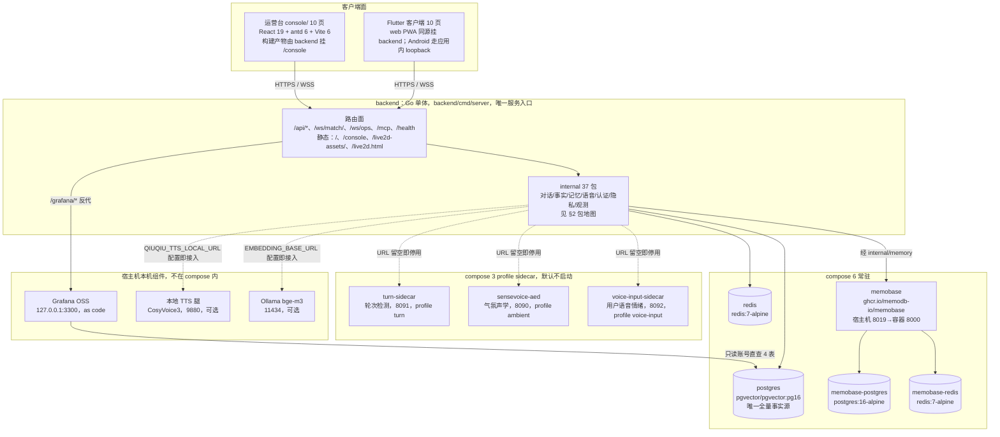
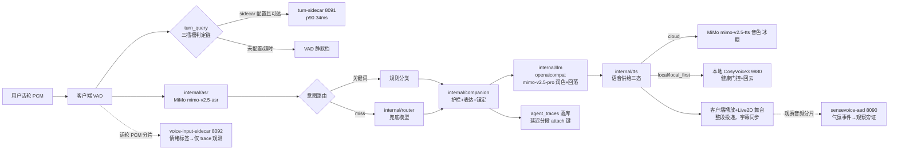
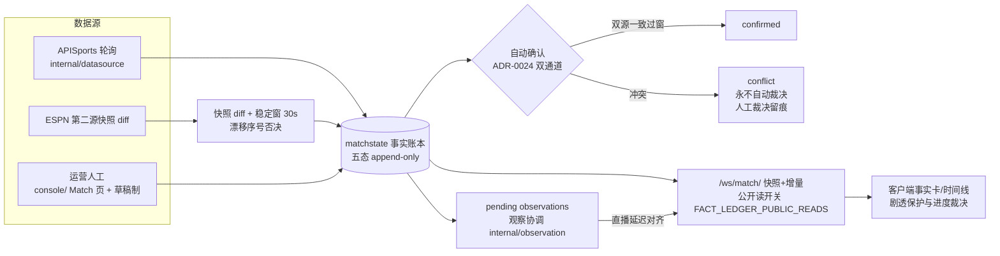
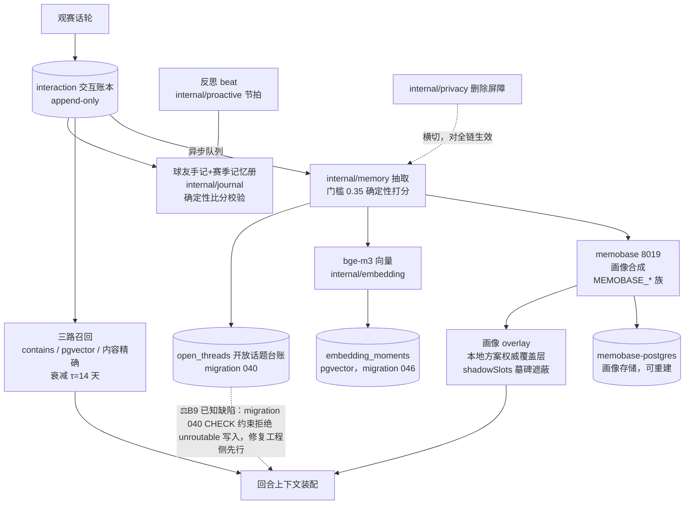
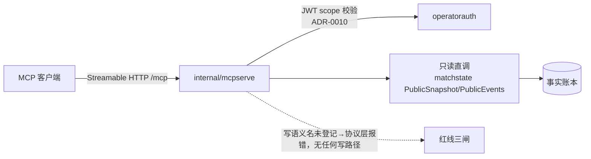

# 19 架构总览

> 本篇基线：2026-06-07 仓库 a7e5100。

**本篇定位**：工程与运行层的第一篇，回答「这套系统由什么组成、边界在哪、东西怎么流」。全部条目为查表体：每一服务、端口、包名、路径都对应基线代码里的真实存在，图的每个节点可与 `docker-compose.yml`、`backend/internal/`、`backend/cmd/` 逐一对上。部署操作、环境变量全集与端口断裂的修复路径归 23 篇；性能预算与 SLO 归 21 篇；语音链路细则归 20 篇。

**导读**：§1 系统全景与部署单元｜§2 backend 单体与包地图｜§3 数据流三线｜§4 知识域与 MCP 只读层｜§5 观测栈｜§6 认证三路｜§7 架构决策指针｜§8 验收（部署自检）｜§9 新工程师第一周｜§10 设计说明。

**事实依据**：本篇全部「现网」声明以 2026-06-07 仓库 a7e5100 为对照源；无代码承载的表述一律写「规划中（未实现）」。环境变量与端口全集的登记表在 23 篇，本篇只给架构位置。

---

## 1. 系统全景与部署单元

### 1.1 全景图

现网是一个 Go 单体加它的存储与 sidecar 家族，单机 docker compose 部署。唯一的对外应用入口是 backend：C 端 web、运营台静态页、实时 WebSocket、HTTP API、MCP 只读层全部从它走；存储与 sidecar 都在 compose 私有网络内，不直接对公网发布端口。

### 1.2 compose 六常驻

登记表（服务名/镜像/职责/网络位置与 `docker-compose.yml` 一一对应）：

| # | 服务 | 镜像 | 职责 | 网络与持久化 |
| --- | --- | --- | --- | --- |
| 1 | `backend` | 仓库内 `backend/Dockerfile` 三阶段构建 | 唯一应用进程：HTTP API、WebSocket、/mcp、静态托管双路径、迁移执行、隐私清理 | 发布 `${PORT:-8080}:8080`；依赖 postgres healthcheck |
| 2 | `postgres` | `pgvector/pgvector:pg16` | 唯一全量事实源：业务表 + 事实账本 + 画像 + 向量（migration 001 起 `CREATE EXTENSION vector`） | 不发布宿主机端口；卷 `postgres_data`；healthcheck `pg_isready` |
| 3 | `redis` | `redis:7-alpine` | compose 常驻预留；backend 读取 `REDIS_ADDR` 但当前代码无 Redis 客户端，去重/冷却等短状态实际由 Postgres 与进程内存承载 | 不发布端口；卷 `redis_data`（无消费方） |
| 4 | `memobase` | `ghcr.io/memodb-io/memobase:latest` | 可变记忆合成（画像槽、事件摘要），经 `internal/memory` 适配；ADR-0006：永不接触比赛事实写路径 | 发布 `8019:8000`；挂 `deploy/memobase/config.yaml`；依赖自身 pg/redis 健康 |
| 5 | `memobase-postgres` | `postgres:16-alpine` | memobase 专用存储，独立口令，不与主库共用 | 不发布端口；卷 `memobase_postgres_data`；healthcheck |
| 6 | `memobase-redis` | `redis:7-alpine` | memobase 专用队列 | 不发布端口；healthcheck |

诚实注记两条：其一，`redis` 是 compose 常驻但 backend 代码当前没有 Redis 客户端（`go.mod` 无 redis 依赖，`config.RedisEnabled()` 无调用方），且 redis 服务未挂载任何卷——compose 底部声明的 `redis_data` 卷无服务挂载——v2 叙事里「去重、冷却走 Redis」已不成立，短状态的实际承载是 Postgres 表与进程内存；服务保留为预留位，不是谎报依赖的理由。其二，健康检查只盖数据层：postgres 与 memobase-postgres 走 `pg_isready`、memobase-redis 走 `redis-cli ping`（均 5s 间隔），backend 与 memobase 本体无 healthcheck；各服务全部 `restart: unless-stopped`。

### 1.3 三 profile sidecar（默认不启动）

三条旁路 sidecar 共用一条纪律：**URL 留空即整体停用**（backend 对其无 `depends_on`、无健康依赖，sidecar 不可达时静默失败，主链路无感）；profile 隔离，`docker compose up -d` 不拉起，按 profile 显式启用。

| 服务 | profile | 端口 | 形态 | 宪法线 |
| --- | --- | --- | --- | --- |
| `turn-sidecar` | `turn` | 8091 | Python/FastAPI，LiveKit EOU 多语版（v0.4.1-intl）本地 ONNX 推理；`POST /turn` 收话轮文本返 `{probability, isComplete}`；模型不入镜像，`scripts/turn-model/download.mjs` 落盘宿主机后卷挂 | 无状态、不落盘；不可用时判定链自动下探静默档 |
| `sensevoice-aed` | `ambient` | 8090 | SenseVoice AED 音频事件检测（欢呼/嘘声/音量骤变）；镜像为占位名，真镜像未落地，pr/本地用 `backend/cmd/ambient-fake` 提供同形状确定性服务 | 气氛信号只作观察旁证（最低权重档），永不作 Match Fact、永不进事实账本（ADR-0002） |
| `voice-input-sidecar` | `voice-input` | 8092 | Python/FastAPI，sherpa-onnx SenseVoice 离线情绪分类；`POST /affect` 收整段话轮 PCM 返 `{label, confidence}`；模型未就位返回 503，Go 侧静默丢弃 | 情绪标签只作语音 trace 观测（偏置开关默认关），永不进比赛事实账本（ADR-0002） |

另有两条**非 compose 的可选本机组件**：本地 TTS 腿（CosyVoice3 docker，宿主机 9880，OpenAI 兼容 `/v1/audio/speech`，经 `QIUQIU_TTS_LOCAL_URL` 接入语音供给三态，见 20 篇）与本地 Ollama（11434，bge-m3 嵌入，服务端事件嵌入与 backend 向量召回两路共用形态）。

### 1.4 外部供应商边界

全部外部依赖经适配包调用，超时与熔断由 `internal/resilience` 统一执行（llm/tts/asr/ambient 四客户端各持一个进程内熔断器）；任何一家失败都有确定性降级路径，不让用户收到错误页（NFR-P-003）。供应商密钥全部环境注入（23 篇族 C/E），代码与仓库不含真实凭证。

| 供应商 | 端点（默认） | 用途 | 适配包 | 失败收缩 |
| --- | --- | --- | --- | --- |
| MiMo | `api.xiaomimimo.com/v1` | LLM（mimo-v2.5-pro）、ASR（mimo-v2.5-asr）、TTS（mimo-v2.5-tts）、Memobase 抽取 LLM 复用同凭证 | `llm`/`openaicompat`、`asr`、`tts` | 润色回落确定性话术；TTS 字幕兜底（云腿故障时「本地优先」态自动回云） |
| APISports | `v3.football.api-sports.io` | 赛程/事件轮询主源 | `datasource` | 按延迟判活→degraded/offline→人工接管；密钥留空则纯导播供数 |
| ESPN | 快照端点 | 比分第二源（快照 diff + 稳定窗自动确认） | `datasource` | 快照缺失时自动确认停摆，人工通道照常 |
| Local TTS / Ollama | 宿主机 9880 / 11434 | 本地语音腿 / bge-m3 嵌入 | `tts`（供给三态）、`memory`+`embedding` | 留空即不存在；探测失败门控置灰、向量路降级关键词 |

### 1.5 单入口与静态托管双路径

backend 一个进程托管全部对外面，没有独立网关层：

| 路径 | 承载 | 说明 |
| --- | --- | --- |
| `/` | Flutter web 构建产物（PWA） | `resolveWebAppDir()`，默认 `../client/build/web`，`QIUQIU_WEB_DIR` 可覆盖 |
| `/console`（308 → `/console/`） | 运营台 Vite 构建产物 | 默认 `../console/dist`，`QIUQIU_CONSOLE_DIR` 可覆盖；hash 路由 SPA |
| `/ws/match/` | 陪看实时会话 | WebSocket hub（`internal/ws`） |
| `/ws/ops` | 运营观测实时流 | 复用鉴权链升级；wire 字段层面无正文 |
| `/mcp` | 只读账本 MCP server | Streamable HTTP，同进程同端口，不起新进程（§4） |
| `/grafana/*` | Grafana 同源反代 | 仅 `QIUQIU_GRAFANA_URL` 配置时注册（§5） |
| `/live2d-assets/`、`/live2d.html` | Live2D 舞台资产 | CORS 全开；`operator-live-state.js` 强制 no-cache |
| `/api/*` | 会话、隐私三权、画像、赛程、控制台 API | `/api/sessions/`、`/api/me/*`、`/api/console/*` 等 |
| `/health` | 进程存活 | WS hub 直接应答；健康不是产品状态，比分可信度只看事实账本确认态 |

---

## 2. backend 单体与包地图

### 2.1 组装根与 cmd

生产入口只有一个：`backend/cmd/server`。实时路由、静态托管、迁移执行（advisory lock + `schema_migrations` 账本，按文件名排序）、隐私清理定时器都活在这一个进程里；进程启动按依赖顺序打开全部 Postgres 存储，任何一环失败即 `log.Fatal`——基础设施不可用与配置缺失同罪，快速失败。包边界不靠运行时隔离，靠 import 方向纪律与评测锁定：`interaction`（账本）不知道 `memory`（画像）的存在，`matchstate` 的事实不会被 `relationship` 改写。

`backend/cmd/` 全集（9 个可执行 + 1 个资产目录）：

| 入口 | 用途 |
| --- | --- |
| `cmd/server` | 唯一生产入口 |
| `cmd/evals` | 离线评测 CLI（`-suite all` 出 `artifacts/evals/offline.json`） |
| `cmd/eval-audit` | 对运行实例按 citation 前缀深查 trace，出审计报告（读 `APP_TOKEN`） |
| `cmd/latency-test` | 语音链路延迟测量 |
| `cmd/verify-datasource` | 外部比赛数据源连通性验证（读 `APISPORTS_API_KEY`） |
| `cmd/ambient-fake` | 气氛旁路假 sidecar（同形状确定性，pr/本地验证接线） |
| `cmd/voice-fake` | 语音情绪假 sidecar（同上，读 `VOICE_SIDECAR_PORT`） |
| `cmd/turn-sidecar` | 轮次检测 sidecar 本体（Python，见 §1.3） |
| `cmd/voice-input-sidecar` | 语音情绪 sidecar 本体（Python，见 §1.3） |
| `cmd/artifacts/` | 资产目录（韵律盲测音频对与答案键），非可执行 |

### 2.2 internal 37 包地图

每包一句话，按职责分组；包名与 `backend/internal/` 目录逐一对应：

**会话与对话**

| 包 | 职责一句话 |
| --- | --- |
| `conversation` | 观赛会话编排：投递去重、主动发言门禁、打断调度与让路、赛点档 |
| `companion` | 对话决策核心：意图分类、表达实现、边界护栏、工具注册表单一源 |
| `router` | LLM 意图路由：关键词 miss 时兜底分类，`ROUTER_API_KEY` 缺失回落 `MIMO_API_KEY`，双缺则整层停用 |
| `proactive` | 主动调度时间维度：与 WS 无关的用户级提醒簿 + 服务端节拍，错过（开球+30 分钟）翻 suppressed 转记忆素材 |
| `backchannel` | 伴随反应通道：短语级微反应，不是话轮（ADR-0016） |
| `structured` | `openaicompat` 之上的结构化输出接缝（JSON 形态约束） |
| `speech` | 语音链路文本切分原语（句聚合） |

**比赛事实**

| 包 | 职责一句话 |
| --- | --- |
| `matchstate` | 比赛状态机：事实账本、比赛时钟、目录、冲突调和，兼 Postgres 存储与迁移执行器 |
| `event` | 比赛事件模型：导播行为条与事实事件的公共定义 |
| `datasource` | 外部数据源：APISports 轮询、ESPN 第二源快照、按延迟判活、人工接管切换 |
| `observation` | 待确认观察跨连接协调：确认、撤销、跟进与过期（延迟-事实协调） |
| `interaction` | 交互账本：append-only，唯一本地事实源（migration 031 起） |
| `teamalign` | 球队名对齐叶子工具：口语别名 → 赛程全名 |

**记忆与知识**

| 包 | 职责一句话 |
| --- | --- |
| `memory` | 记忆抽取队列、画像合并（overlay 为权威覆盖层）、三路召回（contains/pgvector/内容精确）、时序衰减、健康徽标 |
| `journal` | 球友手记与赛季记忆册：reflection 产能的消费面，确定性比分校验防编造 |
| `embedding` | OpenAI 兼容 `/embeddings` 最小客户端（bge-m3 语义向量） |
| `knowledge` | 知识域（第二事实域，ADR-0017）：repo 策展条目的检索式作答（§4） |
| `relationship` | 关系状态机：互动账本九类累积、阶段推进、角色设置 |

**语音**

| 包 | 职责一句话 |
| --- | --- |
| `asr` | 语音识别客户端（MiMo `mimo-v2.5-asr`，中文） |
| `tts` | TTS Provider seam：`Synthesizer` 接口唯一调用面，表演指令（情绪→自然语言 instruct）映射 |
| `ttssupply` | 语音供给三态（cloud/local/local_first）持久化与读取（`ops_settings` 表） |
| `useraffect` | 用户语音情绪旁路客户端：标签只作观测/偏置信号，永不进事实账本 |
| `ambient` | 气氛声学旁路客户端与事件形状：只作观察旁证，永不进事实账本 |
| `llm` / `openaicompat` | 模型客户端与 OpenAI 兼容传输层（/chat/completions 共享） |

**运营台与鉴权**

| 包 | 职责一句话 |
| --- | --- |
| `auth` | C 端会话：匿名身份 + 访问/刷新令牌签发、刷新与吊销（argon2id 凭证升级，migration 049） |
| `consoleauth` | 运营台人类通道：PBKDF2-SHA256 ×100k 口令、JWT 登录/刷新、首登强制改密 |
| `operatorauth` | 运营员身份接缝（ADR-0008/0010）：个人令牌机器通道 + 密码人类通道，同一 Claims 同一 scope |
| `operatorwrite` | 运营写：`Idempotency-Key` 幂等包裹、实名审计、草稿制 |

**隐私、韧性与观测**

| 包 | 职责一句话 |
| --- | --- |
| `privacy` | 导出、删除 job（横切 enforcement）、墓碑、保留期清理（6 小时一拍） |
| `resilience` | 熔断器：llm/tts/asr/ambient 四客户端各持一个，进程内状态 |
| `deliverykey` | deliveryKey 字符串协议：幂等与去重的键规范单一源 |
| `directordraft` | 导播语音草稿：ASR 转写 + LLM 抽取成事件草稿 |
| `mcpserve` | 只读账本 MCP server：官方 go-sdk Streamable HTTP，挂 `/mcp`，四只读工具（§4） |
| `evals` | 评测脚手架：交互审计、旅程 runner（评测资产索引见 24 篇） |
| `ws` | WebSocket hub：握手、Origin 校验、每 IP 5 连接上限、读限 1MB、读 60s/写 10s |
| `config` | 环境变量加载与启动校验，生产硬门（全集见 23 篇） |

---

## 3. 数据流三线

三条主数据流把能力族串在同一个单体上。图中的每个箭头都对应真实的函数调用或表写入；细则归各承接篇。

### 3.1 语音实时线（整段投递形态）

首响预算 3-7 秒（NFR-P-001）；断句判定经 turn sidecar 的路径 p90 ≤34ms，sidecar 不可用时三插槽判定链自动回落 VAD 静默档（NFR-P-002）。

### 3.2 事实确认线（账本纪律）

账本五态 append-only；ESPN 第二源快照 diff + 稳定窗 30 秒自动确认 + 漂移序号否决（ADR-0024），与运营人工确认构成双通道；冲突永不自动裁决。细则与状态机归 14 篇。

### 3.3 记忆异步线（抽取-召回-反思）

ADR-0006 分工：交互账本是本地唯一事实源，Memobase 只做可变画像合成、永不接触比赛事实写路径；抽取失败只记日志与降级徽标，绝不影响回复。细则归 16 篇（系统）/08 篇（可感面）。

> ⚖️B9 脚注：`040_open_threads.sql` 的 CHECK 约束存在 unroutable 缺陷，合法写入会被拒；修复先行（工程侧开单），受影响的开放话题台账在修复落地前按缺陷现状如实记录，不写成已闭环。登记见 37 篇。

---

## 4. 知识域与 MCP 只读层

### 4.1 知识域（第二事实域）

ADR-0017 立的知识域与比赛事实账本并列为第二事实域：条目库 `backend/knowledge/`（rules 100 + players 21 = 121 条 YAML），DB 表 `knowledge_entries`（migration 053）为唯一可写源（策展台编辑后 repo YAML 只是 seed），`057_knowledge_worldinfo.sql` 落 worldinfo 参数学。作答形态是**检索式**（门判门槛 100，双路评分融合取 max，向量路余弦阈值 0.55 可调），不是生成式 RAG；无出处的生成式知识作答在「明确不做」清单（PRD 1.4.3）。目录经 `KNOWLEDGE_DIR` 配置，留空即 `knowledge_question` 无实质回答。规则细则归 15 篇。

### 4.2 MCP 只读层

`internal/mcpserve` 把比赛事实账本暴露为只读 MCP server：官方 go-sdk Streamable HTTP 形态，挂现有 server 的 `/mcp` 路径，不起新进程新端口。四个只读工具，名字与描述来自 `companion.ToolRegistry` 单一源：`match.read_snapshot`、`match.search_events`、`match.get_player_timeline`、`schedule.read_today`。鉴权走 ADR-0010 运营台同体系：匿名一律 401，刻意不继承 legacy `APP_TOKEN`/开发旁路，缺只读 scope 403。红线三闸（NFR-SEC-008）：工具声明 MutatesMatchFacts 全 false、包源码无账本写路径 token、未登记写语义名协议层报错；MCP 工具结果永不进比赛事实账本。

---

## 5. 观测栈

观测面由三层组成，全部只读、只出聚合数（ADR-0021）：

| 层 | 承载 | 位置 |
| --- | --- | --- |
| 指标面板 | Grafana as code：「qiuqiu 运营观测」6 面板（语音总延迟 P50/P90、延迟分段均值、播放期打断率、微反应对白名单、投递七态分布、主动触达送达率） | **本机 127.0.0.1:3300，不在 compose 内**；provisioning 三件（dashboards/datasources/alerting）在 `deploy/grafana/` |
| 告警 | rules.yml 组 `qiuqiu-operations` 4 条：语音延迟 P95>3000ms（15m 窗 for 5m）、首响 P95>1800ms（句粒度拆除后**休眠保留**）、供应商错误>3 条/30m（熔断落库代理）、api-sports poller 停摆>600s；通知钉钉（contact point 类型 `dingding`）+ webhook 双集成 | `/ws/ops` 饱和丢弃**有意不规则化**（内存计数无落库面，不造代理凑数） |
| 实时流与运营台 | `/ws/ops` 实时流 + console 概览页九格指标 + 「观测」页 kiosk 内嵌 Grafana（`QIUQIU_GRAFANA_URL` 配置时经 `/grafana/*` 同源反代，未配置显占位卡） | 同 backend 进程 |

只读边界（NFR-SEC-007）：Grafana 经只读账号 `qiuqiu_grafana_ro`（`deploy/grafana/init.sql` 建号，仅 SELECT agent_traces / interaction_ledger / delivery_ledger / proactive_reminders 四表）直查，物理上写不了账本；面板 SQL 只出聚合数字、禁止正文列。值班响应分级 S0-S3 与演练记录归 27 篇；告警阈值口径以 21 篇为准。

---

## 6. 认证三路

三路凭据分别签发与校验，互不通用；运营令牌进不了用户实时通道。全部细节（哈希参数、令牌 TTL、刷新轮换、scope 全表）归 22 篇；这里登记架构位置。

| 路 | 形态 | 代码位置 |
| --- | --- | --- |
| 匿名（默认） | 设备标识换匿名身份，短期会话令牌；`026_anonymous_device_identities.sql` 持久基础；登出≠失忆（ADR-0020） | `internal/auth` |
| C 端登录（可选升级） | 邮箱/用户名+密码原地绑凭证，argon2id（`049_user_credentials.sql`）；access 15min / refresh 30 天，刷新令牌单次使用、存 SHA-256 hash | `internal/auth` |
| 运营台 | 双通道：人走用户名+密码（PBKDF2 ×100k，JWT HS256，`QIUQIU_JWT_SECRET`，首登强制改密）；机器走个人令牌 Bearer（`APP_TOKEN`/`APP_TOKEN_SECONDARY` 常量时间比较）；写操作统一 `operator:match:write` scope + 幂等 + 实名审计 | `internal/consoleauth`、`internal/operatorauth`、`internal/operatorwrite` |

开发/生产差异：`APP_ENV=production` 强制 session 认证模式、`APP_TOKEN`/`MIMO_API_KEY`/`SESSION_SIGNING_KEY`（≥32 字符）缺失拒绝启动；非生产 loopback 来源默认放行、开发档缺省签名密钥自动生成本地值。环境变量全集与三层硬门见 23 篇。

---

## 7. 架构决策指针

本篇不复制 ADR 内容，只立指针：全量索引（10 篇 + superseded 反向指针）见 36 篇；与本篇架构直接咬合的决策：

| ADR | 决策一句话 | 本篇落点 |
| --- | --- | --- |
| ADR-0002 | 情绪/气氛信号永不进比赛事实账本 | §1.3 sidecar 宪法线、§3.1/§3.3 旁路虚线 |
| ADR-0006 | 记忆接缝 Memobase 适配器：账本是唯一本地事实源 | §1.2 服务分工、§3.3 记忆异步线 |
| ADR-0008/0010 | 运营台身份与 JWT 双通道 | §6 认证三路 |
| ADR-0016 | backchannel 不是话轮 | §2.2 包地图 |
| ADR-0017 | 知识域独立于事实账本 | §4.1 |
| ADR-0020 | 终端用户登录凭证接缝（匿名默认） | §6 |
| ADR-0021 | 运营观测只读旁路（Grafana） | §5 |
| ADR-0022 | MCP 工具层只读 | §4.2 |
| ADR-0024 | 数据源自动托管信任分级确认 | §3.2 事实确认线 |

---

## 8. 验收（部署自检）

本篇挂一道人工自检（完整版与命令形态在 23 篇 §7）：按 §1 全景逐项核对——

1. `docker compose ps`：6 常驻全部 Up（postgres healthcheck 通过后 backend 才起），3 profile sidecar 默认不在列；
2. `GET /health` 200；`/` 返回客户端页、`/console/` 返回运营台登录页（hash 路由）；
3. `schema_migrations` 计数与 `backend/migrations/` 文件数一致（59，引用一律按文件名）；
4. Grafana 未配置时 console「观测」页显占位卡——这是预期行为，不是缺面板；
5. 三旁路 URL 留空时语音链路照常（判定链下探静默档），配置后 sidecar 停摆只降级不报错；
6. 外部供应商缺省降级面与 §1.4 表一致：`APISPORTS_API_KEY` 留空走纯导播供数，`MIMO_API_KEY` 留空（非生产）字幕兜底可跑通文字路径。

---

## 9. 新工程师第一周（onboarding 路径）

> 2026-06-09 生命周期增补。本节是入职第一周的最低配套路径，不是培训大纲；30-60-90 目标页与 mentor/buddy 制**规划中（未实现，P1）**。

### 9.1 阅读路径（六篇，顺序即依赖序）

| 序 | 读什么 | 回答什么 |
| --- | --- | --- |
| 1 | 00 篇（产品总纲） | 产品是什么/不是什么；§6 文档治理宪法（改规范先读它） |
| 2 | 02 篇（里程碑叙述） | 现在到哪一步、版本与里程碑怎么记 |
| 3 | 06 篇（语音体验） | 用户可感面：一场陪看会话长什么样 |
| 4 | 14 篇（比赛事实） | 账本纪律：说错必改、冲突不自动裁决怎么做到 |
| 5 | 16 篇（记忆系统） | 记忆异步线：抽取-召回-反思（本篇 §3.3 的细则承接篇） |
| 6 | PRD 第一章 | 需求口径与产品定位原文 |

### 9.2 跑通清单（三条全过＝第一周交付）

| # | 跑通项 | 命令/入口 | 通过标准 |
| --- | --- | --- | --- |
| 1 | compose 起全栈 | `docker compose up -d` | §8 部署自检第 1-4 条过：6 常驻 Up、/health 200、/ 与 /console/ 可达 |
| 2 | 评测套件跑通 | `go run ./cmd/evals -suite all`（backend/ 下） | 离线 234 例出绿档报告（命令口径见 24 篇 §8.1） |
| 3 | 陪看会话走通 | web 端进演示比赛（`isDemoMatchID` 白名单，27 篇 ONC-53）走一轮会话 | 至少一轮真实话轮闭环：回复送达、`agent_traces` 落库可查 |

卡住即登记：跑通清单任一条走不通，按 §8 自检逐项排除；排除不了的是文档缺口或环境缺陷，开单登记而不是口口相传——新人改新人文档是本路径的保鲜机制（首次走通后回写本节的过时命令/路径）。

### 9.3 who-to-ask

领域找人的通讯录 owner **待指派**（挂 00 篇 §6.9 DRI 条款「待指派→正式指派」约定，指派落 27 篇职责表）；指派落地前按「本篇 §2 包地图定位包 → 篇末修订记录/git blame 找最后修改人」追溯，不设「什么都问同一个人」的默认。

---

## 10. 设计说明

1. **文体判定**：本篇是工程层 reference——查表承载结构事实，图承载拓扑；与 v2 档案 46-系统架构图集（explanation 叙事 + 多视角图集）的分工是：那里讲「为什么这样画图」，这里逐节点对代码。图全部重绘，不迁移 v2 的抽象节点（「导演台」「资格裁决模块」等），一律落真实服务名/包名/端口。
2. **与 v2 46 章的差异（增量）**：v2 全景是「一个单体 + 存储三件套」；v3 增补四块——① sidecar 家族（turn/ambient/voice-input 三 profile + 语音供给本地腿 + Ollama，v2 成文时不存在）；② 知识域与 MCP 只读层（ADR-0017/0022，v2 无）；③ 观测栈（Grafana as code + 告警三件套 + `/ws/ops`，v2 明写「没有独立告警系统」，现网已有）；④ 认证从「用户/导播台/运营写三路凭据」收敛为「匿名/C 端/运营」三路 + 机器通道（ADR-0010 落地后的真实形态）。
3. **删「双人复核」幻影**：v2 46 章 §6.5「导演台的候选到发布流程」含「独立复核/双人复核」节点——现网运营写是 18 个写端点中 2 类走草稿制、其余幂等直接生效，实名归因审计替代复核人；「双人复核」无代码承载，v3 不再绘制该节点。v2 图集中「影子审计（新旧比分引擎并行）」与「干预级别三档」同样无现网对应，一并不入本篇（后者的人工接管真实形态归 26/30 篇表述）。
4. **redis 的诚实降级**：v2 两篇把「去重、冷却」记在 redis 名下；基线代码无 Redis 客户端，本篇按现状登记为「预留常驻、无消费方」。这是 v3「现网为真」纪律的执行样本：compose 里的服务不等于被依赖的能力。
5. **图的组织**：只保留三张数据流图（三线）+ 一张全景 + 一张 MCP 图，比 v2 图集（30+ 张）收敛。理由：多视角图集服务于对外讲解，规范篇服务于对码核对；视角叙事留在档案（9x.档案 v2-20260922），不随迁移进入 v3。
6. **裁决点引用纪律**：本篇出现的 ⚖️B9（migration 040 CHECK 缺陷）、⚖️B11（本地端口断裂，落 23 篇）均为引用，登记与裁决流转唯一落点 37 篇；修复落地后本篇 §3.3 脚注与 23 篇端口表同步摘除。
7. **onboarding 节为什么落在架构篇（2026-06-09 生命周期增补）**：第一周路径的六篇阅读序以「能力承载」为纲（定义→里程碑→可感面→事实→记忆→需求原文），跑通清单三条全部落在 §1-§3 的部署单元与数据流上——新人走通清单的过程就是对本篇查表真实性的逐项核验；who-to-ask 的 owner 待指派是 00 篇 §6.9 DRI 条款的首个登记位，正式指派后本节随之转正式通讯录。

---

## 修订记录

| 版本 | 日期 | 依据 | 变更摘要 |
| --- | --- | --- | --- |
| v3.0 | 2026-06-08 | PRD v3.0 第五章 NFR 与 1.4 形态；docker-compose.yml / backend/internal / backend/cmd 逐项核对（基线 a7e5100）；ADR-0002/0006/0008/0010/0016/0017/0020/0021/0022/0024；迁移源 v2 档案 46-系统架构图集 | 初版。建立系统全景（6 常驻 + 3 profile sidecar + 本机观测/TTS/嵌入组件）、backend 包地图（37 包 + 10 cmd 入口）、数据流三线图、知识域与 MCP 只读层、观测栈、认证三路、ADR 指针、部署自检；redis 无消费方与 ⚖️B9 缺陷如实脚注；删 v2「双人复核」等无代码承载节点 |
| v3.0.1 | 2026-06-09 | 2026-06-09 生命周期增补（LC） | 新增 §9「新工程师第一周」onboarding 路径：阅读路径六篇（00→02→06→14→16→PRD 第一章）/跑通清单三条（compose 起/`go run ./cmd/evals -suite all` 跑通/演示比赛陪看会话走通）/who-to-ask（owner 待指派，挂 00 篇 §6.9 DRI 条款，指派落 27 篇职责表）；原 §9 设计说明顺延为 §10 并补第 7 条（onboarding 节落位理由）；元数据与导读锚点同步 |
| v3.0.2 | 2026-06-09 | 2026-06-09 终审收口（FIN2；终审报告 P2：正文流程词中性化） | §9 章首引语「2026-06-09 生命周期增补（LC）」改「2026-06-09 生命周期增补」——内部批次名清理出正文，改中性日期标注；增补事实与条款语义无改动 |
