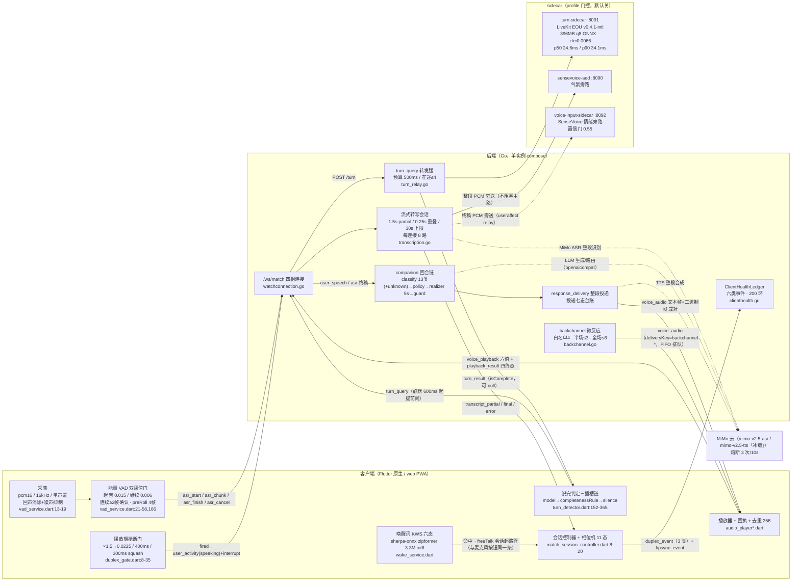

# 20 语音链路 runbook

> 本篇基线：2026-06-07 仓库 a7e5100。全部「现网」表述以该基线代码为准，逐节点标实现位置。

**本篇定位**：语音链路的工程运行手册。它回答四个运行问题：链路由哪些组件组成、每个节点谁负责（§1）；打断权如何分级、每类消息谁可打断谁（§2）；打断生命周期有哪些事件、落在哪里（§3）；每一环怎么算失败、失败了去哪查（§4~§6）。体验面参数的「用户看到什么」归 06 篇，本篇写「代码在哪、怎么验、坏了怎么修」。**语音链路权威序（与 06 篇 §2 头同步）**：参数源=规范附录 B｜工程源=本篇（代码出处/实现位置唯一归此）｜体验源=06 篇｜需求源=PRD FR-VOICE 各条。

**分工表**：

| 主题 | 本篇条目 | 细则归属 |
| --- | --- | --- |
| 链路组件图、端口、逐节点代码出处、时序走查 | §1 | — |
| 打断策略三级分级、默认动作与证据保留 | §2 | 红线口径归 01 篇（VOX-02/RED-04） |
| 打断生命周期事件全集与遥测位置 | §3 | 协议字段全集归 18 篇 + 附录 C |
| FP/FN 失败定义与测试矩阵 | §4 | 评测套件结构归 24 篇 |
| 延迟分段预算与观测对账 | §5 | 体验口径（首响 3-7s 的体验含义）归 06 篇 |
| 按症状排查（检查点/日志位置/处置） | §6 | 值班演练链路归 oncall 档 |
| 已知边界、观测待补、规划中项 | §7 | 37 篇裁决点登记 |
| 语音退出链路工程承载（时延预算待定义） | §2.2 第 9 行、§7 | 体验与退出途径归 05/12 篇 |

**导读**：§1 链路总览｜§2 打断策略分级｜§3 事件全集｜§4 FP/FN 矩阵｜§5 延迟预算｜§6 故障排查｜§7 边界与待办｜§8 验收挂钩｜§9 设计说明。

---

## 1. 链路总览

### 1.1 全链组件与端口图



端口与启动口径：后端 WS /ws/match 随主服务；:8090 气氛 sidecar（compose `profiles:["ambient"]`）、:8091 轮次 sidecar（`profiles:["turn"]`，`QIUQIU_TURN_SIDECAR_URL` 留空=模型插槽整体降级）、:8092 情绪 sidecar（`profiles:["voice-input"]`）——三个 sidecar 默认不随主 compose 启动（docker-compose.yml:148-210）。情绪旁路受 ⚖️B2 约束：结论只进表达层信号族，情绪信号不进事实账本。

### 1.2 逐节点清单

| # | 节点 | 职责 | 关键参数 | 实现位置 |
| --- | --- | --- | --- | --- |
| 1 | 采集 | 开麦、重采样、回声消除 | pcm16/16kHz/单声道/echoCancel+noiseSuppress | `client/lib/services/vad_service.dart:13-19`；web 变体 `client/web/index.html:135-241`（`__qRec*`，preRoll 1 秒=32000B、单段上限 30 秒=960000B，index.html:138-139） |
| 2 | 能量 VAD | 只管「开口」，不管「说完」 | 起音 RMS 0.015 / 继续 0.006、连续 ≥2 帧、50ms 帧、preRoll 4 帧、maxDuration 15s | `vad_service.dart:21-58,165-166` |
| 3 | 说完判定 | 三插槽降级链判停 | 提前问 600ms、节流 300ms、在途超时 450ms、否决上限 2 次；静默档 1400ms（+25%/犹豫，封顶 2000ms，minHesitation 100ms）；completenessRule 插槽预留未接 | `client/lib/services/turn_detector.dart:96-109,406-546` |
| 4 | 抢断门 | 播放期打断判定 | 能量门 0.0225（=0.015×1.5）、时长门 ≥400ms、squash 窗 300ms、段内 fired 锁存 | `client/lib/services/duplex_gate.dart:8-35,64-163` |
| 5 | 回声豁免 | 播放窗内起音且门未 fired 的段不作自动收口 | AutoFinishGuard 挡 maxDuration 与 turn chain 两条自动路径 | `vad_service.dart:64-94,272-287` |
| 6 | 唤醒词 | 免手入口 | 「你好球球」score 1.8 / threshold 0.3 / 冷却 1.5s / 开麦超时 8s；六态状态机；与 VAD 双持麦互斥；平台门 Android/Windows | `client/lib/services/wake_service.dart`、`wake_engine_sherpa.dart`；平台门 `match_screen.dart:255-271` |
| 7 | 流式转写会话 | 序/限/合并 | 1.5s partial 粒度（0.25s 重叠合并）、revision 单调、整段 30s 上限、每连接 8 路、recoverable 错误不终止会话 | `backend/cmd/server/transcription.go:20,98`、`backend/internal/asr/session.go` |
| 8 | ASR 主路 | 语音转文字 | mimo-v2.5-asr、language=zh、hints 热词（主客队名+球员名单）、HTTP 超时 30s、熔断 3 次/10s | `backend/internal/asr/client.go` |
| 9 | 轮次转发腿 | turn_query→sidecar | 预算 500ms（`QIUQIU_TURN_SIDECAR_TIMEOUT_MS`）、在途上限 4（饱和即 null 不排队）、4xx 不计熔断、null 语义一律 | `backend/cmd/server/turn_relay.go:29-44` |
| 10 | turn sidecar | 本地轮次模型推理 | LiveKit EOU v0.4.1-intl、q8 ONNX 396MB、zh 阈值读 languages.json（≈0.0066~0.0067）、历史 128 token/6 轮、串行推理 | `backend/cmd/turn-sidecar/app.py` |
| 11 | 回合链 | 意图→决策→润色→护栏 | classify 13 类 + unknown（miss 时 LLM 路由兜底；match_reaction 为主动回合别名不独立计）、realizer 5s 超时回落确定性话术、guard 四检共用 | `backend/internal/companion/`、`backend/internal/relationship/policy.go` |
| 12 | 投递 | 整段合成、整段投递 | voice_audio 文本帧+二进制帧成对；投递七态；TTS 三态供给（cloud 默认/local/local_first+健康门控）；回退不变量（不中途换腿） | `backend/internal/conversation/response_delivery.go`、`backend/internal/tts/supply.go` |
| 13 | 微反应 | 伴随反应短语音 | 白名单 4 事件、半场 ≤3/全场 ≤6、风暴去重 10s、让路 userSpeaking、短语 ≤10 字、TTS 预算 5s 失败即弃 | `backend/internal/backchannel/backchannel.go:17-26,98`、`backend/cmd/server/backchannel_audio.go:16` |
| 14 | 打断收口 | 停排程+表演下行 | `user_activity(speaking)`/`interrupt` → `scheduler.Interrupt()` + `interrupt(expression=listening)`；被抢占一次性 confused/listening 反应 + 环形 20 条 | `watchconnection.go:1044-1050,1118-1125`、`backend/cmd/server/delivery.go:185-302` |
| 15 | 健康观测 | 遥测落点 | 六类健康事件、结构化日志、转写只记 rune 数 | `backend/internal/observation/clienthealth.go`、`watchconnection.go:1264-1287` |
| 16 | 连接保护 | 四相生命周期 | 每 IP ≤5、单帧 1MB、读 60s/写 10s、服务端 ping 30s、客户端心跳 25s、看守重验 30s | `watchconnection.go`、`backend/internal/config/config.go` |

### 1.3 一次话轮的时序走查（how-to）

以「用户在球球播报时插话问：刚才谁助攻？」为例，全链按时间序：

1. **开口**（客户端）：50ms 帧流经 VAD，连续 2 帧 RMS>0.015 确认语音，preRoll 4 帧补进句首——首音节不被判定延迟吃掉（`vad_service.dart:293-300`）。
2. **边说边传**：`asr_start`（声明 pcm_s16le/16000Hz/单声道/zh）→ `asr_chunk`（base64，序号递增）→ 屏幕出现 `transcript_partial`（每累计 1.5s 一帧，revision 递增）。
3. **插话判定**（若球球正在播报）：抢断门逐帧观测。播放起音 300ms 内的段整段忽略（squash，回声主防线）；起音满 400ms 持续、能量≥0.0225 → `fired`，段内锁存只触发一次（`duplex_gate.dart:94-149`）。
4. **打断上行**：控制器发 `user_activity(state=speaking)` + `interrupt`，本地暂停播放（`match_session_controller.dart:925-931`）。
5. **服务端收口**：`scheduler.Interrupt()` 停排程，回 `interrupt(expression=listening)`（`watchconnection.go:1118-1125`）；被抢占回合投递记 interrupted，一次性 confused/listening 反应下发并入 interruptionRing（20 条，`delivery.go:273-287`）。
6. **说完判定**：静默累计 600ms 起，`turn_query` 携 partial 文本经转发腿问 sidecar（预算 500ms）；`isComplete=true` 提前判完；null/超时/否决 2 次下探静默档 1400ms（`turn_detector.dart:279-300,444-489`）。
7. **转写终稿**：`asr_finish` → `transcript_final`；MiMo 云识别（~297ms 往返参考），识别失败携 `fallbackAudio` 随 `user_speech` 整段重提（降级矩阵第一级）。
8. **回合生成**：classify 归 recent_event → 事实账本取锚源 → policy 出 TurnPlan（[analyze]，三句 160 字）→ realizer 5s 润色 → guard 四检 → 整段 TTS（「冰糖」）→ `voice_audio` 成对下行。
9. **播放与回执**：客户端播放，`playback_result(completed)` 实报推进投递七态；期间用户再开口则回到第 3 步。

### 1.4 旁路与唤醒的入口口径

- **唤醒入口**：KWS 仅在「比赛页前台 + 收音会话未激活」时 armed；唤醒走与麦克风按钮同一条 freeTalk 会话起路径，不另起链路；VAD 收音起则 KWS 挂起放麦（双持麦避让）。设置页默认关（opt-in）。
- **两条旁路**（默认关，profile 门控）：气氛旁路把每个合法 `asr_chunk` 原样旁送 AED sidecar（8090），不阻塞主识别路径，结论受比赛事实域气氛旁证三道闸约束；情绪旁路（8092）置信门 0.55、新鲜窗 2 分钟，结论合并进话轮 trace 作策略偏置。两条旁路的结论永不参与比分、事件确认与账本状态（⚖️B2 口径：情绪信号不进事实账本）。
- **存储纪律**：整段 PCM 只在合法会话内存中保留至终稿（供旁路取用），识别完成即释放；不落盘、无音频存档。

### 1.5 本链使用的 WS 消息面速查（reference）

协议全集（上行 20 类、下行 19 类）以 18 篇 + 附录 C（协议字典）为对账基准；本表只列语音链路运行会碰到的消息及方向，供排查时对线：

| 方向 | 消息 | 触发点 | 备注 |
| --- | --- | --- | --- |
| 上行 | `asr_start` / `asr_chunk` / `asr_finish` / `asr_cancel` | 流式转写会话四件套 | start 声明 pcm_s16le/16000Hz/单声道/zh，服务端硬校验；chunk 带递增序号；自动附 timezone |
| 上行 | `user_speech` | 整段形态话轮（含重连补发、流式失败 fallbackAudio 重提） | 携 talkativeness 档位，服务端解析并持久化 |
| 上行 | `user_activity`（state=speaking\|idle） | VAD 开口/收口 | speaking 使服务端取消排程与查询（等价打断的轻量面） |
| 上行 | `interrupt` | 抢断门 fired 或手动打断 | 服务端停排程并回表演下行 |
| 上行 | `turn_query` | model 插槽提前问（静默 600ms 起） | utteranceId 关联，服务端转发 sidecar |
| 上行 | `voice_playback` / `playback_result` | 播放状态与终态实报 | 六值/四终态双回执；blocked 双端映射 skipped |
| 上行 | `duplex_event` / `lipsync_event` | 自愈/降级/恢复遥测；嘴型退化遥测 | 正文不入日志，只记 rune 数 |
| 下行 | `match_snapshot` → `match_clock` | 握手后首两条下行，次序固定 | `/ws/match` 从不发送 `welcome`（该消息仅存于 /ws/ops 变体）——反幻影锚点 |
| 下行 | `transcript_partial` / `transcript_final` / `transcript_error` | 识别过程三类回推 | revision 单调，客户端丢弃旧版防倒灌；error 带 recoverable |
| 下行 | `turn_result` | sidecar 结论回填 | isComplete 可 null（未配置/超时/熔断），null 即降级语义 |
| 下行 | `voice_audio`（文本帧+二进制帧 成对） | 回合音频与微反应音频 | 微反应变体 deliveryKey=`backchannel-*`、无 traceId/eventId |
| 下行 | `voice_status`（failed / text_fallback / tts_fallback） | 降级矩阵三态通知 | 每级失败用户可见，无静默失败 |
| 下行 | `interrupt`（expression=listening） | 打断确认与表演收缩 | — |
| 下行 | `presentation`（source=delivery_interrupted） | 被抢占一次性 confused/listening 反应 | deliveryKey=`delivery-interrupted:<traceID>` |
| 本地合成（不上线） | `reconnecting` | 客户端断线重连 UI 事件 | 服务端从不收发，反幻影锚点 |

---

## 2. 打断策略分级表

### 2.1 三档分级定义

- **可打断**：全双工（`duplex_playback_capture` 默认开）下，用户语音过抢断门三条件即可截断该路音频；截断后误打断自愈、连续误断自动降级。
- **仅唤醒词可入**：收音会话未开（KWS armed 态）时，环境语音一律不进链路——不产生话轮、不触发任何打断判定；唯一免手入口是「你好球球」命中（过评估门参数），命中后走正常会话起路径，此后受全套表达护栏约束（01 篇 VOX-06：唤醒态免检路径违规）。
- **不可打断**：物理上不存在打断判定（半双工播放窗），或判定上被门/红线挡住（squash 候选段、短促声响、用户说话时的球球让路）。「用户打断球球」永远合法（01 篇 VOX-02：用户说话永远优先于球球说完）；「球球打断用户」不存在——用户语音不是可打断对象，是让路的绝对方。

### 2.2 分级表（按消息/场景类型）

表 A——球球的下行语音（用户打断球球）：

| # | 消息/场景类型 | 分级 | 默认动作 | 证据保留 |
| --- | --- | --- | --- | --- |
| 1 | 用户话轮回复语音（reply audio） | 可打断 | 门 fired → `user_activity(speaking)`+`interrupt` 上行 → 本地暂停播放 + 服务端 `scheduler.Interrupt()` + `interrupt(listening)` 下行；抢断后话轮 <4 字且与刚播文本重叠 ≥0.5 判误打断，恢复续播 | 投递七态 interrupted；`playback_result(interrupted)` 实报；`duplex_event(self_interrupt_suspected/degraded/recovered)`；interruptionRing（20 条，`GET /api/console/delivery-interruptions`） |
| 2 | 比赛事件主动播报（match_reaction，含关键事件） | 可打断；对用户是让路方 | 同第 1 行；排程寿命以事件类型为底（关键 45s/普通 12s，`main.go:1212-1217`），决策携带 TTLSeconds 时覆盖（30s/90s，`policy.go:427`）；被抢占回合触发一次性 confused/listening 反应（interruptedReactionGuard 防重复） | 同第 1 行 + `observeReplyOutcome(interrupted)` 落账；被打断本身回执入账本可复盘 |
| 3 | 初见问候（first_meeting 排程，30s TTL） | 可打断 | 用户开口即 `scheduler.Interrupt()` 取消排程；已投递的问候按普通播放可断 | 投递台账；`first_meeting_status`（delivered/skipped+reason） |
| 4 | 微反应短 TTS（backchannel） | 可打断（按普通播放中断处理），但自身永不顶替正文 | 音频走客户端 FIFO 队列排队不插队；被抢断门打断时 interrupted/skipped 实报落账、迟到只记 client_late；合成失败即弃永不重试、退回纯文字 | 不进投递七态台账（无 traceId/eventId）；trace `backchannel.emit` + 互动账本 `backchannel` 类 |
| 5 | 事实修正/观察跟进话轮 | 可打断（用户优先），修正本身不因打断丢失 | 打断后由误打断自愈续播；若比分在语音回合前后修订，同文本按新事实重生成再发（in-band 刷新）；撤回事实触发的主动回复随撤回事件移除 | trace 理由码；账本 fact_revision 类 |
| 6 | 半双工播放窗（总开关关或自动降级中） | 不可打断（物理） | 播放期 VAD 事件整体忽略、不报 `user_activity`；恢复只走惰性退避（3min 起步、翻倍、封顶 30min）或设置页手动重开（重开即重置退避与连击） | `duplex_event(duplex_degraded/duplex_recovered)`；ClientHealthLedger；恢复/降级 notice 文案 |
| 7 | squash 窗内起音 / <400ms 候选段 | 不可打断（不产话轮） | 抢断门 suppressed/rejected，段收口后判定全部重来；AutoFinishGuard 同步豁免两条自动收口路径 | 门内静默——无事件无日志（观测待补，见 §7） |
| 8 | 用户语音（上行方向） | 不可被球球打断 | 球球话轮 `InterruptMode` 默认 `never`（不打断用户）；用户在说时取 `after_user` 等用户说完再播（`policy.go:427-436`）；用户开口同时取消排程查询与主动排程（`watchconnection.go:1044-1050`） | `DeliveryPolicy.InterruptMode` 随 trace；排程取消落账本 |
| 9 | 「再见/退出」语音退出（FR-VOICE-023） | 规划中（未实现，P0）；落地后为最高级不可拦截 | 规划语义：语音退出指令 → 立即停止语音输出 → 结束陪看会话 + 停主动排程；挽留语义为红线（01 篇 RED-04），「先挽留再说再见」违规 | 现网底座：session_closed 双向、打断链路（第 1 行）、应用退出；端到端断言「无任何后续语音输出」为落地验收项 |

表 B——分级速查：

| 分级 | 覆盖行 | 一句话 |
| --- | --- | --- |
| 可打断 | A1/A2/A3/A4/A5 | 全双工下抢断门三条件即断；断错自愈，断多了自动退半双工 |
| 仅唤醒词可入 | KWS armed 态 | 收音窗未开，说话不进链路；「你好球球」是唯一免手门铃 |
| 不可打断 | A6/A7/A8 + 退出指令（落地后） | 半双工物理不可断；门内候选不成话轮；用户语音永远优先 |

### 2.3 打断执行链与自愈（how-to）

打断不是单点开关，是一条五步执行链（代码路径见 §1.2 第 14 行）：

1. **门判定**（客户端，纯函数）：`PlaybackInterruptGate.observe(rms)` 逐帧产出 inactive/suppressed/armed/fired/rejected 五决策；fired 段内锁存不回退。
2. **上行**：`user_activity(speaking)` 使服务端 `userSpeaking` 置位并取消排程；`interrupt` 触发 `scheduler.Interrupt()`。
3. **下行确认**：`interrupt(expression=listening)` 回程，客户端表演收缩为中性。
4. **定谳**：抢断后的话轮转写到达时 `looksLikeSelfInterrupt`（<4 字 + 重叠 ≥0.5）判误打断——恢复被停播放（`ResumeInterruptedPlaybackCommand`）+ streak+1；真话轮则 streak 清零。
5. **降级/恢复**：streak 达 3 → `duplex_playback_capture=false` + `duplex_degraded`；此后用户播放期开口那一刻惰性判定退避（3min 起步翻倍封顶 30min），满即恢复 + `duplex_recovered`，本次开口直接按抢断路径生效。手动重开设置页开关等价重置。

处置要点：降级是保护不是故障（外放/嘈杂环境的预期响应）；恢复无后台定时器——用户不开口就永不恢复，这是设计不是缺陷（FR-VOICE-016）。

### 2.4 半双工形态速查（reference）

「不可打断」态有三条进入路径与两条退出路径，排查打断类问题时先对这张表定位当前形态：

| 路径 | 进入方式 | 持久性 | 退出方式 |
| --- | --- | --- | --- |
| 用户总开关 | 设置页「抢话打断」关闭（`duplex_playback_capture=false`） | 持久偏好 | 用户重开开关（重置误打断连击与恢复退避） |
| 自动降级 | 连续 3 次误打断（`selfInterruptStreak≥3`） | 临时响应 | 播放期开口 + 退避满（惰性恢复）或手动重开 |
| 按键说话 | pushToTalk 模式 | 模式选择 | 模式切换（收音窗口由用户手势决定，本就不走门） |

- 判定单源：`match_session_controller.dart:177-231`（`_duplexPlaybackCapture`、`setDuplexPlaybackCapture`）；VAD 侧以 `setPlaybackCaptureEnabled` 同步开关（`vad_service.dart:119-121`），关闭即 `gated=false`、门不观测、`speech_start` 照历史行为立即上报。
- 自动降级与手动重开共用同一入口（`setDuplexPlaybackCapture`），重开即清零连击、清退避——降级是对连续回声的临时响应，不追责到下一次会话。
- 恢复时序：`_maybeRecoverDuplex` 只在 `vadSpeaking` 的降级分支被调用（播放期开口那一刻）；恢复成功即为本轮退避翻倍（封顶 30min），供下次降级使用（`match_session_controller.dart:235-252`）。

---

## 3. 打断生命周期事件全集（taxonomy）

### 3.1 生命周期阶段 × 事件对照

本节给出打断生命周期的规范事件名，并逐一对到现网承载：已实现的写实现位置，现网没有的标「观测待补（规划中）」——不得以现网语气书写待补项。

| 生命周期阶段 | 规范事件名 | 现网承载 | 状态 |
| --- | --- | --- | --- |
| 收音窗开启 | speech_started | 客户端 `VADEvent.speaking`（`vad_service.dart:337-342`，播放期须过门：`speechStartPasses` 判定）→ 控制器上行 `user_activity(state=speaking)`（`match_session_controller.dart:925`） | 已实现 |
| 打断候选形成 | interruption_candidate | `PlaybackInterruptDecision.armed`（候选段累计中）/ `suppressed`（squash 压制）/ `rejected`（未过时长门收口）——纯进程内枚举（`duplex_gate.dart:38-53`），无日志、无遥测 | 观测待补（规划中）：候选/压制/拒绝三决策无事件面，FP 归因依赖真机会话 |
| 打断判定成立 | interruption_decision | 门 `fired`（`duplex_gate.dart:146-149`）→ `VADEvent.speaking` 上报 + `user_activity(speaking)` + `interrupt` 上行 + 本地 `PauseAudioCommand`（`match_session_controller.dart:927-931`） | 已实现 |
| 服务端确认 | interruption_ack | `scheduler.Interrupt()` + `interrupt(expression=listening)` 下行（`watchconnection.go:1118-1125`）；`user_activity(speaking)` 路径同时 `scheduleLookups.Cancel()` | 已实现 |
| 被抢占反应 | preempted_reaction | 一次性 confused/listening 投递（deliveryKey=`delivery-interrupted:<traceID>`，`delivery.go:255-268`）+ `interruptionRing.Record`（20 条环形，`delivery.go:185-216`） | 已实现 |
| 误打断定谳 | false_positive（自愈向） | `self_interrupt_suspected` duplex_event 上行（transcript 只记 rune 数，`match_session_controller.dart:970-975`）+ 服务端结构化日志 + ClientHealthLedger（`watchconnection.go:1264-1276`）+ 恢复续播（`ResumeInterruptedPlaybackCommand`） | 已实现 |
| 自动降级 | degraded | `duplex_degraded` 上行（连续 3 次误打断，`match_session_controller.dart:977-984`）→ 同上落日志与账本 | 已实现 |
| 惰性恢复 | recovered | `duplex_recovered` 上行（退避满 + 播放期开口，`match_session_controller.dart:235-252`）→ 同上 | 已实现 |
| 假阳性（漏方向） | false_positive（漏拦向） | 「回声未被门拦下、直接成话轮」与「真话轮 <4 字被自愈吞掉」两个方向现网均无事件——自愈判定只覆盖「抢断后判回声」单方向 | 观测待补（规划中）：漏拦向无遥测，只能靠 §4 矩阵离线评测与真机走查兜住 |
| 嘴型退化伴生 | lipsync_degraded | `lipsync_event`（vendor_unavailable / decode_failed / jitter_fallback 三 reason，`watchconnection.go:1277-1287`） | 已实现 |
| 语音退出 | voice_exit | 语音语义退出链路整体规划中（未实现，P0，FR-VOICE-023）；现网无对应事件 | 规划中（未实现，P0） |

### 3.2 遥测与日志位置（reference）

| 观测面 | 内容 | 位置 |
| --- | --- | --- |
| 结构化日志（服务端） | `voice duplex event: user/match/event/transcript_len/streak`——正文不入日志，只记 rune 数 | `watchconnection.go:1274-1275` |
| 结构化日志（服务端） | `voice latency event: user/match/signal/stage/elapsed_ms`——五锚点见 §5 | `watchconnection.go:191-199` |
| 健康账本 | 六类事件计数 + 最近 200 条事件环（kind/at/matchId，无用户身份无正文） | `backend/internal/observation/clienthealth.go`；`GET /api/console/client-health`（console_api.go:161） |
| 打断环 | 最近 20 条被抢占投递（traceId/matchId/时刻） | `GET /api/console/delivery-interruptions`（console_api.go:167） |
| trace 合并 | asr_final 与 turn 结论事后 attach 进已落库 trace（AttachVoiceStages 键级合并，含 TTS 元数据） | `watchconnection.go:205-251` |
| 客户端进程内 | VAD 六态、门五决策、相位机 11 态——只驱动 UI，不上 wire | `vad_service.dart`、`duplex_gate.dart`、`match_session_controller.dart:8-20` |

### 3.3 关键事件载荷字段（reference）

排查时核对 wire 载荷与日志字段的形状（字段全集仍以 18 篇 + 附录 C 为准）：

| 载荷 | 字段 | 说明 |
| --- | --- | --- |
| `duplex_event` 上行 | `event`（self_interrupt_suspected / duplex_degraded / duplex_recovered）、`transcript`（仅 self_interrupt 携带）、`streak` | 服务端日志只落 `transcript_len`（rune 数）与 `streak`；`streak` 为连续误打断计数 |
| `playback_result` 上行 | `deliveryKey`、`state`（completed/interrupted/skipped/failed）、`reason` | 只随带 deliveryKey 的音频发送；迟到回执只记 client_late |
| `turn_query` / `turn_result` | `utteranceId`、`text` / `isComplete`（可 null）、probability（观测透传） | utteranceId 一一配对；文本不入服务端日志 |
| `voice latency event` 日志行 | `user` / `match` / `signal` / `stage` / `elapsed_ms` | stage 五值见 §5；锚点缺失直接跳过（无 elapsed 基准的噪音行不打） |
| `interrupt` 下行 | `expression=listening` | 客户端 `match_screen.dart:536` 消费，表演收缩为中性 |
| ClientHealthEvent | `kind` / `at` / `matchId` | 无用户身份、无正文——聚合口径按 Operations Observation 纪律 |

---

## 4. FP/FN 测试矩阵

六场景定义「怎么算误报（FP）、怎么算漏报（FN）」。全部场景对齐 evals 语音族与运行时 E2E；改任何门参数先让对应用例红、再改实现绿（v2 档案 49 章纪律平移）。

| # | 场景 | 输入形态 | 期望（现网行为） | FP（误报） | FN（漏报） | 失败信号与挂钩资产 |
| --- | --- | --- | --- | --- | --- | --- |
| 1 | 真修正（说错重说） | 「刚才 2 比 1——不对，是 1 比 2」：句中停顿后自我修正 | 停顿期间模型插槽否决（vetoActive），静默档不得抢判；修正句完整转写（revision 防旧盖新） | 停顿被静默档抢判→球球抢答半句 | 说完 1400ms+ 仍不收口→干等 | turn_cases A 类提前截断率上升；`client/tool/turn_detection_eval.dart`；evals voice `asr-repeat`/`asr-trailing` |
| 2 | 嗯嗯 backchannel | 伴随性短应答「嗯嗯」「哇」；球球微反应「（小声）」 | 用户「嗯嗯」按正常话轮走（VAD 确认+判停+回合）；球球微反应 FIFO 排队不顶替正文、userSpeaking 时让路禁发 | 微反应在用户说话时插播；微反应音频顶替主回合 | 白名单事件该出而被限频全吞（半场 3 条额度零消耗且零输出） | `backend/internal/backchannel/backchannel_test.go`（限频/白名单/让路）；evals voice 13 例族；Playwright 音频去重 spec |
| 3 | 噪声（电视/欢呼） | 稳态电视解说；播放期进球欢呼 | 稳态噪声零误开口（0.015+2 帧确认）；播放期欢呼不误断（0.0225+400ms+300ms 三门）；回声候选不被自动收口 | 幻影话轮（噪声成转写）；播放期误断→self_interrupt streak 升 | 小声真话（RMS<0.015）开不了口 | `tests/evals/client-vad.spec.mjs` 3 例红；`duplex_gate` 单测红；evals voice `asr-noise-guard`；真机 streak 持续走高（§6 症状 1） |
| 4 | 唤醒词 | 「你好球球」正样本；53.1s 负样本音频 | armed 态 10/10 唤醒、0 误触；VAD/KWS 互斥无双持麦；非前台零持麦；web 零启用（stub 排除） | 负样本误唤醒（falseTriggers>0） | 正样本漏唤醒（wakeRate<1） | `scripts/wake-eval` 复跑偏离 FINAL-nihao-s1.8-t0.3.json；调参未重过评估门即上线=违规 |
| 5 | 静默超时 | sidecar 未配置/超时/熔断（null 语义） | 客户端 null 粘滞下探静默档，判停稳定发生在 1400-2000ms 带；服务端零 sidecar 专属分支 | 否决窗内（vetoActive）静默档抢判→吞后半句 | 否决后静默档永不接管→话轮挂起 | `turn_detection_eval` 判停分布出带；800/1000ms 固定值复辟=违规（FR-VOICE-006 反例）；sidecar 拔除演练（§6 症状 2） |
| 6 | 长数字播报（半句比分） | 「下半场是 4 比——」（半句停顿）；「2 比 1」类主张 | 模型判未说完不抢答；数字主张走观察跟进不当事实（疑问词区分主张/询问） | 0.5 类通用阈值抢答（zh 实测已否决，校准值 ≈0.0066） | 整句说完仍不判（sidecar 否决应 2 次后弃远程走静默） | turn_cases A5；evals voice `asr-number-claim`/`asr-ok-score`；同文本否决计数超 2 仍发远程=违规（FR-VOICE-005） |

运行方式（本地复现）：

```bash
# turn 离线评估线（判停分布/提前截断率）
cd client && dart run tool/turn_detection_eval.dart
# 语音族离线套件（ASR 元数据/噪声兜底，Go 侧）
cd backend && go test ./... -run Eval
# 客户端 VAD/麦克风三套（真实浏览器，注入受控音频）
npx playwright test tests/evals/client-vad.spec.mjs tests/evals/client-microphone.spec.mjs
# 运行时 E2E pr 档（含四件与 voice-ui-smoke）
node scripts/evals/run.mjs --tier pr
```

### 4.1 新增场景的接入纪律（how-to）

矩阵是开放清单，新增失败场景按四步接入，不落矩阵的失败形态不得进入排障口径：

1. **先写「怎么算失败」**：给出 FP/FN 定义与可判定的失败信号（能量带、阈值、事件序列），落本表新行；
2. **选承载**：能量/判定类场景优先 turn_cases / duplex_gate 纯函数评估线（无需采集栈）；链路类场景落 evals JSON 用例或 Playwright spec；
3. **红绿纪律**：新场景先在现网参数下跑出基线，参数改动先红后绿；
4. **真机校准**：凡涉及真实声学（回声/外放/欢呼），浏览器合成结果只作回归，放行判据以真机会话为准（ADR-0023 域差纪律同源）。

---

## 5. 延迟预算表

分段预算，全部标出处；「实测」列为现网采集口径，非承诺值。

| 段 | 参数/预算 | 实测/口径 | 出处 |
| --- | --- | --- | --- |
| 采集帧节奏 | 50ms/帧（16kHz） | — | `vad_service.dart`（`turnFrameMs=50`，turn_detector.dart:23） |
| 开口确认 | 连续 ≥2 帧（=100ms）+ preRoll 4 帧（≈200ms）补偿 | 首音节零丢失（preRoll 对冲判定延迟） | `vad_service.dart:24,166` |
| 抢断判定 | squash 300ms + 时长门 400ms | 播放期起音到 fired 最早 ≈400ms；800ms 抢话门目标在浏览器假麦克风环境不可评估，正式对照留真机（voice-transport-upgrade 在案）——400ms 是现网门值 | `duplex_gate.dart:27-30`；FR-VOICE-014 |
| 说完判定·model 插槽 | 静默 600ms 起提前问；节流 300ms；在途超时 450ms；转发预算 500ms | sidecar 推理 p50 24.6ms / **p90 34.1ms**（串行锁，≈1 次/300ms 查询节奏） | `turn_detector.dart:29,408-429`；`turn_relay.go:30`；FR-VOICE-004 |
| 说完判定·静默兜底 | 1400ms 基础；+25%/犹豫停顿；封顶 2000ms；minHesitation 100ms | 离线评估决策产物：截断率 0，最坏失败形态从「抢答」换成「干等」 | `turn_detector.dart:96-109`；FR-VOICE-006（过渡档，换代挂 smart-turn-v3.2 评测） |
| ASR | partial 每 1.5s 一帧（0.25s 重叠）；HTTP 超时 30s；熔断 3 次/10s | 真 MiMo 往返 ≈297ms（真网参考值） | FR-VOICE-008/009；`backend/internal/asr/client.go` |
| 意图路由 | 关键词 miss 时 LLM 路由兜底 | 秒级（专项延迟以实测工具为准；ROUTER_API_KEY 缺省回落 MIMO_API_KEY，都没有则整层关闭回纯关键词） | `backend/internal/companion/classify.go`、`router/router.go` |
| 润色 | 5s 超时（`COMPANION_REALIZER_TIMEOUT_MS`，夹 1-10000） | 超时回落确定性话术（trace 记 `realizer_error/unavailable`） | NFR-P-003；`companion/realize.go` |
| TTS 合成 | 整段合成；熔断 3 次/10s；微反应 one-shot 预算 5s 失败即弃 | 三态供给 cloud/local/local_first；回退不变量（不中途换腿） | `backend/internal/tts/`；`backchannel_audio.go:16` |
| **首响（整段口径）** | — | **3-7 秒**：经裁决接受的现实（韵律盲测 80% 嫌弃句粒度后拆除，判据线 30%）；不设为指标承诺、不作对外卖点 | FR-VOICE-012（裁决 e35c3fe）；NFR-P-001 |
| 服务端管线内部段 | — | 0-14ms（不含云调用） | FR-VOICE-024 |
| 观测告警 | 语音延迟 P95 >3000ms（15m 窗、持续 5m）；tts_first_audio P95 >1800ms（锚点随整段拆除休眠、规则保留）；供应商错误 >3；poller 600s | 判断值 3000/1800/3/600 为准；告警正身与文案残差注记（rules.yml 旧值 5000/2500）唯一出处：21 篇 §3.1 | `deploy/grafana/provisioning/alerting/rules.yml`；FR-VOICE-024 |
| 发布闸门 | latency-test 五场景（进球/黄牌/半场/射门/开场）P50/P95 | **P95<3s 为发布闸门** | `backend/cmd/latency-test/main.go:119-121` |

观测对账（how-to）：任一话轮在 trace 中可查五段分解——`speech_received → asr_finish → asr_final → turn_decided → audio_delivered`（锚点表容量 64、满则整表重置；迟到消息日志行静默缺失是已知边界，不影响业务）。锚点缺失组（非本连接话轮/纯文本轮）整组跳过，与日志行跳过语义一致。

### 5.1 四条告警规则明细（reference）

告警 as code（ADR-0021 同源纪律：告警 SQL 与面板 SQL 同表同列同算法，改规则走评审）；数据源一律 qiuqiu-ledger 只读账号。**告警正身（四条判断值+休眠注记+文案残差注记）唯一出处：21 篇 §3.1**；本表为值班排查视角的运行明细，判断值或注记变更只改源表：

| # | 规则 | 判断值 | 口径与注记 |
| --- | --- | --- | --- |
| ① | 语音延迟 P95 超阈 | P95 > 3000ms，15m 窗、持续 5m 报 | `agent_traces.latency_ms` percentile_cont（latency_ms>0），同「语音总延迟 P50/P90」面板口径仅分位 0.9→0.95（文案残差注记见 21 篇 §3.1） |
| ② | 供应商错误计数 | >3 | 熔断器是进程内状态不可查，换型为 `agent_traces.error` 非空计数（LLM/TTS/ASR 错误率）——熔断开启必有连续失败先行落库 |
| ③ | tts_first_audio 首响 | P95 > 1800ms | **锚点随句粒度拆除休眠、规则保留**——现网整段路径无首帧概念，声称该告警现役监控为违规口径 |
| ④ | poller 停摆 | 600s | 换型为 api-sports 事件在 match_events 落库停摆（provider 事件断流代理）；仅统计近 24h 有事件的窗口，noDataState=OK |

通知通道：钉钉（contact point 类型 `dingding`）+ 通用 webhook 双集成，恢复通知开；2026-06-03 值班演练全链闭合（20 条真故障注入→firing→双通道实收→恢复→resolved 实收）。

---

## 6. 故障排查手册

按症状排查。每条给：现象 → 检查点 → 日志位置 → 处置步骤。

### 6.1 症状一：抢话误触发（电视声/呐喊导致球球断播）

- **检查点**：① 误打断判定是否生效（<4 字 + 重叠 ≥0.5 双条件）；② streak 是否连续 3 次触发自动降级；③ 门参数是否被改动（0.0225/400ms/300ms 三值单一来源 `PlaybackGateParams`）。
- **日志位置**：服务端 `voice duplex event ... event=self_interrupt_suspected streak=N`；`GET /api/console/client-health`（self_interrupt_suspected / duplex_degraded 计数与事件环）；`GET /api/console/delivery-interruptions`（被抢占回合环）。
- **处置步骤**：
  1. 确认第 1、2 次误打断是否自愈续播（自愈成功=预期保护在工作）；连续 3 次降级半双工同样是预期行为，不是故障。
  2. streak 高企但自愈全部成功 → 典型外放环境：建议用户改用耳机（回声消除对外放漏音的抑制有限）。
  3. 若真话轮（≥4 字）被误判自愈吞掉 → 属漏拦向假阳性（§3.1 无遥测方向）：取真机会话录音走 §4 场景 3 离线复现，调门参数须先让 duplex_gate 单测在新值下红、真机对照通过后再改。
  4. 参数调整不得直接上线：真机抢话门对照在案待做（§7），门值变更挂 voice-transport-upgrade。

### 6.2 症状二：不接话（说完球球长时间不应答）

- **检查点**：① 三插槽链停在哪一级（turn_result 是否 null 粘滞）；② sidecar `/healthz`；③ `QIUQIU_TURN_SIDECAR_URL` 是否配置；④ 否决上限（同文本 2 次）是否耗尽后静默档接管。
- **日志位置**：`voice latency event`（speech_received→asr_final→turn_decided 各段 elapsed）；trace 的 AttachVoiceStages 合并段；`transcript_error.recoverable`。
- **处置步骤**：
  1. `curl http://<host>:8091/healthz`——不通即模型插槽降级（预期形态：null 下探静默档 1400-2000ms 判停），链路仍应闭环；若静默档也不收口，查客户端 `RemoteTurnModel` 是否进入 `_unavailable` 粘滞（WS 不可达同置此态）。
  2. turn_decided 段 elapsed 异常大 → 查转发腿在途是否饱和（上限 4/连接，饱和即 null 不排队）与 500ms 预算配置。
  3. asr_final 缺失 → 查熔断器（ASR 连续 3 次失败开 10s）与降级矩阵第一级（fallbackAudio 整段重提）是否工作。
  4. 全链慢 → 跑 `backend/cmd/latency-test` 五场景对 P95<3s 闸门，分段归因到 LLM/TTS 云腿。

### 6.3 症状三：回声自闭环（球球自己的声音触发收音或打断）

- **检查点**：① 采集是否带回声消除（`echoCancel: true`，vad_service.dart:13-19；web 走浏览器约束）；② squash 窗与 AutoFinishGuard 是否在位（播放窗起音且门未 fired → 豁免 maxDuration 与 turn chain 两条自动收口）；③ 是否半双工形态（总开关关=播放期不收音，物理无回环）。
- **日志位置**：回声候选被门静默豁免，**无专门日志**（观测待补，§7）；间接信号——transcript_partial 出现与刚播文本高度重叠的内容、随后 `self_interrupt_suspected`。
- **处置步骤**：
  1. 复现路径：外放环境让球球播报长句，观察是否出现与播报同文的幻影转写。
  2. 幻影转写成话轮（未被门拦）→ 属漏拦向假阳性：离线用 `evaluatePlaybackInterrupt` 喂回声 RMS 序列复现门行为，确认 squash/时长门语义未被改。
  3. 被打断后自愈连环触发 → 同症状一处置第 2 步（耳机/降级）。
  4. web 变体注意平台差异：preRoll 1 秒（32000B）、单段上限 30 秒（960000B）与原生（4 帧/15s）不同源，排查时勿混用参数。

### 6.4 症状四：惰性恢复不回来（降级后半双工一直不恢复）

- **检查点**：① 恢复判定只挂在「用户播放期开口」时机——用户不开口永不恢复（无后台定时器，设计如此）；② 退避序列（3min 起步、翻倍、封顶 30min）是否到期；③ 是否中途再降级（退避翻倍）。
- **日志位置**：`duplex_recovered` 事件（出现即已恢复）；ClientHealthLedger 最近事件环的时间戳可推算降级时刻；客户端 notice 文案（「连续误打断，已暂时改回半双工…」「已恢复抢话…」）。
- **处置步骤**：
  1. 用账本事件时间戳计算 `now - degradedAt` 与当前应退避值比对：未到期=预期，等下一个开口时机。
  2. 用户要求立即恢复 → 引导设置页重开「抢话打断」开关（`setDuplexPlaybackCapture(true)` 重置连击与退避）。
  3. 到期且有过播放期开口仍不恢复 → 查 `vadSpeaking` 降级分支是否被相位条件挡住（仅 `speaking` 相位或初见问候期生效）；属代码缺陷则按 §4 场景 3/§3.1 补观测后修。

### 6.5 症状五：唤醒词失灵（喊了不应 / 频繁误醒）

- **检查点**：① 状态机六态（disabled/starting/armed/awakening/suspended/failure）——armed 前提=比赛页前台 + 开关开 + 平台门内（Android/Windows；web stub 排除、iOS 留位）；② 双持麦避让——VAD 收音会话激活时 KWS 挂起放麦（「喊了不应」若发生在会话中=预期）；③ 冷却 1.5s（连续喊不二次唤醒）；④ 模型资产是否落盘（`scripts/wake-model/download.mjs`，模型不入 git）。
- **日志位置**：客户端 wake_service 状态机（本地）；`scripts/wake-eval/run-eval.mjs` 复跑输出对照 `results/FINAL-nihao-s1.8-t0.3.json`（score 1.8 / threshold 0.3 / 冷却 1.5s）。
- **处置步骤**：
  1. 「会话中喊不应」→ 预期（谁在听谁持麦）；引导结束会话后再唤。
  2. 「前台空闲喊不应」→ 查平台门与开关态、模型资产完整性与 keywords.txt（`client/assets/wake/`）。
  3. 「频繁误醒」→ 复跑评估门：误触必须为 0；调参（score/threshold）必须重新过门后才能上线，未过门组合上线=违规。
  4. 双持麦报错（压测路径）→ 查 starting 在途态穿插竞态处理（wake_service 单测覆盖族）。

### 6.6 症状六：降级矩阵触发（识别失败/合成失败后的连环表现）

- **检查点**：① 失败落在矩阵第几级（流式识别失败→整段重提；整段仍败→文字兜底；TTS 失败→字幕；断线/权限→文字+只读陪看）；② 每级是否有用户可见提示（无静默失败是验收线）；③ 熔断状态（ASR/TTS 各自 3 次/10s）。
- **日志位置**：`transcript_error`（recoverable 布尔）；`voice_status`（failed / text_fallback / tts_fallback + reason/traceId）；trace 的 `realizer_error` / `realizer_unavailable`（润色层超时回落，与 ASR/TTS 层失败区分开）。
- **处置步骤**：
  1. 先分级：用户「说了没反应」多为第一/二级（识别腿），「球球不出声但有字幕」为第三级（合成腿）——两级腿独立可失败，一侧失灵不拖另一侧。
  2. 识别腿失败持续 → 查 MiMo 云可用性与熔断开窗；云恢复后熔断 10s 自动闭合，无需重启。
  3. 合成腿失败 → 查供给三态：cloud 态查云腿；local/local_first 态查本地健康门（30s 周期试合成「你好。」、连续 2 次过门才可选；local 态失败不回云、保持并告警——静默回云即违规）。
  4. 验证收尾：注入故障恢复后，回合应回到正常语音形态；字幕兜底期间文本路径与比赛流全程可用。

### 6.7 症状七：重连后语音异常（重复播报/补发缺失/串台）

- **检查点**：① 重连代际计数是否防住旧连接消息串台；② 补发队列 ≤4 条 FIFO（超限淘汰最旧、已取消话轮绝不补发）；③ 服务端 `session_opened` 后按原 deliveryKey 回放（source=`recovered_delivery`）与客户端去重（容量 256）是否配对。
- **日志位置**：客户端 websocket_service（退避 2^(n-1) 秒钳 1-8s、≤5 次）；服务端 `recoverPendingDeliveries`（只取 resolved 态）；投递台账七态迁移记录。
- **处置步骤**：
  1. 「同一句播两遍」→ 查 deliveryKey 去重器（客户端 `_seenAudio`，容量 256）是否被绕过——回放与补发必须同键。
  2. 「刚说的话丢了」→ 查补发队列淘汰：断线期注入 >4 条时淘汰最旧是设计行为；未取消的话轮被丢弃才是缺陷。
  3. 「第 6 次还在自动重连」→ 违规：上限 5 次，之后转手动/降级路径。
  4. 回归验证跑 `docker-restart-e2e`（服务重启恢复面：状态不丢、已撤事实不重放）与 session-isolation-e2e（会话隔离）。

---

## 7. 已知边界与待办

按「现网为真」如实登记；无代码承载的表述一律「规划中（未实现）」。

| # | 项 | 现状 | 去向 |
| --- | --- | --- | --- |
| 1 | 真机抢话门对照 | 800ms 抢话门目标在浏览器假麦克风环境不可评估（预采数据结论）；现网门值 400ms，正式对照留真机会话 | voice-transport-upgrade 在案（P2 传输档位评估同批） |
| 2 | 用户人耳确认 | 抢断/自愈/降级/恢复全部系统自判定；用户侧只有 notice 文案，无人耳确认环节；韵律盲测覆盖合成韵律、未覆盖打断体验 | 真机走查待办；体验面归 06 篇验收 |
| 3 | smart-turn 录音标注 | 换代评测三件套已落（turn_collection 199 条提示语采集台 / turn_annotation 标注台 / turn_model_compare 双模对比+门判，`--stub` 自测通过）；真实人声采集挂起等素材——合成语音的停顿分布对「说完没」判断有系统性域差，拿合成样本过门=自欺 | smart-turn-v3.2 换代（openspec 在案未收口） |
| 4 | 语音便捷退出 | 「再见/退出」语义 → 立即停止输出 → 结束会话的端到端链路规划中（未实现，P0；《办法》第十九条）；时延预算与误触发率门判待定义（落地后归本篇 §5/§4 补行） | FR-VOICE-023；负例族 evals boundary/baseline |
| 5 | 打断候选遥测 | armed/suppressed/rejected 三决策无事件面；「回声漏拦」「真话轮被自愈吞」两个假阳性方向无遥测 | 观测待补（规划中）：补 duplex_event 事件族或客户端聚合上报后再评门参数 |
| 6 | tts_first_audio 锚点 | 随句粒度拆除休眠（锚点常量与 Grafana 规则保留，复活零成本重接） | FR-VOICE-012 注记 |
| 7 | 麦克风拔出自动回落 | FR 级「自动回落其他设备并界面提示」为幻影声明（F8，规划中，P1）；web 录音机设备枚举回落有 Playwright 锁（client-microphone.spec.mjs:304），两者不混写 | FR-VOICE-022 |
| 8 | Grafana 规则文案残留 | rules.yml 部分 title/summary 残留旧阈值（5000/2500），判断值已是 3000/1800 | 工程侧文案同步待办 |
| 9 | talkativeness_ack 消费 | 后端下发、客户端当前未消费；档位真源是本地保存回调 | ⚖️B12（修文档或修代码二选一） |
| 10 | 情绪旁路默认关 | 两旁路 profile 门控默认不启动；独立用户开关为规划中（⚖️B16）；红线是否收紧待裁决 | ⚖️B2/⚖️B16（37 篇登记） |
| 11 | 观测面单实例边界 | ClientHealthLedger 为进程内环形缓冲，重启清零（遥测非账本）；锚点表满 64 整表重置（迟到消息日志行静默缺失） | 已知边界，如实告知 |

---

## 8. 验收与评测挂钩

本篇验收统一落评测资产与门禁；域级挂钩总表见 PRD 第四章第 3 节，本篇按链路段展开：

| 链路段 | 验收断言 | 资产与挡门 |
| --- | --- | --- |
| 采集与 VAD | 恒定噪声场零误开口；preRoll 首音节完整；播放窗回声不产假话轮 | `client-vad.spec.mjs`（3 例）+ `vad_service` 单测；Playwright 浏览器套件（CI pr 档） |
| 说完判定 | zh 阈值校准值（≈0.0066）否决 0.5；null 降级闭环；判停 1400-2000ms 带；零截断 | turn_cases + turn_detection_eval（门判在案）；换代三件套（挂起等素材）；sidecar `/healthz` 对齐上游参考实现 |
| ASR | 热词命中提升；熔断开合与参数一致；FunASR 评估结论可复跑 | `scripts/asr-eval/`（切换门）；`internal/asr` 熔断单测；evals robust（19 例） |
| 打断与自愈 | 真机「播放中说话→断、电视欢呼→不断」双通过；打断后 300ms 内 listening 下行；注入回声三连击触发降级且前两次自愈；真话轮不被误判 | duplex_gate 单测（门参数用例族）+ 会话控制器单测（自打断判定族）；真机对照在案（§7 第 1 项） |
| 微反应 | 半场注入 10 事件最多 3 条；quiet 零输出；短语 ≤10 字零量化事实；TTS 失败退文字零报错 | `backchannel_test.go`；evals voice（13 例）；Playwright 去重 spec |
| 唤醒 | 评估集 10/10 唤醒零误触复现；VAD↔KWS 交替压测无双持麦；关闭后零持麦 | `scripts/wake-eval/`（调参门）；wake_service 状态机单测 |
| 投递与回执 | 四终态与七态逐态联动；blocked 双端落 skipped；重连零重播；补发最新 4 条顺序正确 | evals regression（26 例）；`delivery.go` 回放单测；session-isolation-e2e / runtime-e2e / interaction-audit / docker-restart-e2e（pr 档四件） |
| 降级矩阵 | 逐级注入故障四级行为逐行命中；全程无静默失败 | evals robust（19 例）；response_delivery tts_fallback 腿单测 |
| 延迟 | 五段分解逐话轮可归因；四条告警按判断值演练通过；P95<3s 闸门 | `latency-test` 五场景；Grafana as code；06-03 值班演练链路 |
| 红线联动 | 打断礼貌（用户优先/不挽留）确定性断言；情绪信号零进账本 | promptfoo 宪法负例门禁（CI 阻断 merge，含让路顺序断言）；trace 审计断言（RED-E1） |

改动纪律：本篇任何参数（门值/阈值/预算/退避）都不是可随手调的旋钮——先让对应用例在新值下红、再改实现绿；涉及打断门与判停的参数变更一律真机对照后放行。

---

## 9. 设计说明

**为什么新立一篇（迁移依据）。** 旧 49/50 两章是 v2 档案里的「真实工程叙事」：以「问题→设计→验证→边界」讲故事，读者能理解每个决定为什么做，但拿它值不了班——没有打断策略分级（谁可打断谁要逐条翻叙事）、没有事件全集（打断生命周期散落在五个 commit 叙述里）、没有 FP/FN 失败定义（测试清单按文件罗列而非按场景）、没有延迟分段预算（数字埋在正文句子里）、没有按症状的排查入口。runbook 体（how-to + reference 混合、分节清晰）补的正是这五样：§2 让「打断权」从叙事变成查表；§3 把生命周期事件从代码注释收拢成对照表并诚实标注观测缺口；§4 把「怎么算失败」写成矩阵；§5 把预算数字对到代码行；§6 给值守一个按症状出发的入口。v3 立篇后，49/50 章降为背景叙事源，工程事实以本篇为准。

**迁移中的修正（旧章表述不再成立处）。** ① 49 章 2.7「麦克风拔出自动回落系统默认」按 web 设备枚举面写成了全平台现网行为——FR-VOICE-022 已定为幻影声明（F8，规划中 P1），本篇 §7 第 7 项分写两层；② 49 章 4 节「不做后台常开收音、没有唤醒词」的边界已被 FR-VOICE-019 KWS 全链推翻——现网有 opt-in 唤醒词（前台空闲态 armed、与 VAD 互斥），本篇按现网写；③ 49 章 2.2 把「静音收句 1400ms」写成 VAD 参数——判停决策权已移交三插槽链（能量线只管开口），1400ms 是静默兜底档的过渡参数，本篇 §1.2/§5 分写；④ 50 章「关键事件 45 秒、普通事件 12 秒」与 policy 层 TTLSeconds（30s/90s）两层并存，本篇 §2.2 第 2 行按「事件类型为底、决策覆盖」如实写。

**与 06 篇的镜像关系。** 同一组现网事实写两遍：06 篇写体验面（用户看到什么、什么是违规口径），本篇写运行面（代码在哪、怎么验、坏了怎么修）。两篇数字同源（附录 B 统一口径），冲突时以带代码出处的一方为准并回修另一方。06 篇 §4.7 留给本篇的「语音退出时延预算（待定义）」在 FR-VOICE-023 落地时随本篇 §5 补行，届时同步补 §4 误触发门判一行。

**runbook 的「观测待补」立场。** §3 把生命周期事件的规范名先立起来（interruption_candidate / false_positive 等），已实现的给实现位置、缺失的明确标「观测待补（规划中）」——这是本篇与旧叙事最大的方法论差异：规范名先于遥测存在，补观测时按名对号入座，而不是等遥测齐了再追认命名。命名先行也让 §4 矩阵的失败信号有稳定词汇可指。

---

## 附录 A：语音链路参数速查（单表）

运行值班与排障的单一查数入口；数字唯一口径为规范附录 B（参数总表），本表为语音域运行展开，每项标单源代码位置。改任何一项都按 §8 改动纪律执行。

| 参数 | 值 | 单源位置 |
| --- | --- | --- |
| 采集规格 | pcm16 / 16000Hz / 单声道 / 回声消除+噪声抑制 | `vad_service.dart:13-19` |
| VAD 起音/继续阈值 | RMS 0.015 / 0.006 | `vad_service.dart:22-23` |
| 开口确认 | 连续 ≥2 帧（50ms 帧） | `vad_service.dart:24` |
| preRoll | 原生 4 帧（≈200ms）；web 1 秒（32000B） | `vad_service.dart:166`；`client/web/index.html:138` |
| 单段上限 | 原生 15s（maxDuration）；web 30s（960000B） | `vad_service.dart:165`；`client/web/index.html:139` |
| 抢断门 | 能量 0.0225（=0.015×1.5）/ 时长 ≥400ms / squash 300ms；段内 fired 锁存 | `duplex_gate.dart:26-31` |
| 静默兜底判停 | 1400ms；+25%/犹豫停顿；封顶 2000ms；minHesitation 100ms | `turn_detector.dart:96-104` |
| 远程判定节奏 | 提前问 600ms；重发节流 300ms；在途超时 450ms；同文本否决上限 2 | `turn_detector.dart:408-412` |
| turn 转发腿 | 预算 500ms（`QIUQIU_TURN_SIDECAR_TIMEOUT_MS`）；在途上限 4/连接 | `turn_relay.go:30-37` |
| turn sidecar | 端口 8091；396MB q8 ONNX；zh 阈值 ≈0.0066~0.0067（读 languages.json）；历史 128 token/6 轮；推理 p50 24.6ms / p90 34.1ms | `backend/cmd/turn-sidecar/app.py:32-48` |
| ASR 会话 | partial 1.5s 粒度（0.25s 重叠）；整段 30s 上限；每连接 8 路；revision 单调 | `transcription.go:20,98`；`asr/session.go` |
| ASR 云腿 | mimo-v2.5-asr、language=zh、hints 热词；HTTP 超时 30s；熔断 3 次/10s | `backend/internal/asr/client.go` |
| TTS 云腿 | mimo-v2.5-tts「冰糖」（`MIMO_VOICE`）；熔断 3 次/10s；`cgSg` 前缀失效音色自动回落默认音色 | `backend/internal/tts/client.go` |
| TTS 供给 | 三态 cloud（默认）/local/local_first；健康门 30s 周期试合成、连续 2 次过门；状态键 `tts_supply`（migration 055） | `backend/internal/tts/supply.go`、`local_health.go` |
| 微反应 | 白名单 4 事件；半场 ≤3 / 全场 ≤6；风暴去重 10s；短语 ≤10 字；TTS 预算 5s 失败即弃；quiet 档禁用；one-shot `Synthesize` 对 ≤10 字无流式需求（SSE 留尾维持为独立任务） | `backchannel.go:17-26,98`；`backchannel_audio.go:16` |
| 误打断判定 | <4 字 且 重叠 ≥0.5；连续 3 次降级 | `match_session_controller.dart:198-200` |
| 惰性恢复退避 | 3min 起步、翻倍、封顶 30min；无后台定时器 | `match_session_controller.dart:206-207` |
| 重连 | ≤5 次；退避 2^(n-1) 秒钳 1-8s；心跳 25s；补发队列 ≤4 条 FIFO | `websocket_service.dart:59,161,178,193` |
| 音频去重 | 客户端 DeliveryDeduplicator 容量 256 | `match_session_controller.dart:170` |
| 连接保护 | 每 IP ≤5；单帧 1MB；读 60s / 写 10s；服务端 ping 30s；看守重验 30s | `config.go:213-227` |
| 唤醒词 | score 1.8 / threshold 0.3 / cooldown 1.5s / openTimeout 8s；模型 3.3M int8 | `wake_service.dart:74-77` |
| 旁路 sidecar | 气氛 8090 / 情绪 8092；情绪置信门 0.55、新鲜窗 2 分钟；三 sidecar 默认关（profile 门控） | `docker-compose.yml:148-210` |
| 延迟观测 | 五锚点；锚点表 64 满则重置；告警判断值 3000/1800/3/600；发布闸门 P95<3s | `watchconnection.go:152-199`；`rules.yml` |
| 主动排程寿命 | 事件类型为底：关键 45s / 普通 12s；决策 TTLSeconds 覆盖：30s/90s | `main.go:1212-1217`；`policy.go:427` |

---

## 修订记录

| 版本 | 日期 | 变更 | 基线 |
| --- | --- | --- | --- |
| v3.0 | 2026-06-08 | 初版：自 v2 档案 49/50 章叙事体重写为语音链路 runbook；链路总览逐节点核代码、打断策略三级分级、生命周期事件全集（含观测待补标注）、FP/FN 六场景矩阵、延迟分段预算、五症状排查手册 | a7e5100 |
| v3.0.1 | 2026-06-09 | 复核修复（对照附录 B §6／PRD FR-DLG-001／07 篇口径） | 复核修复：classify 计数勘误 12 类 → **13 类（+unknown）**——§1.1 链路图与 §1.2 节点 11 两处；match_reaction 为主动回合别名不独立计；与意图注册表 13 命名意图口径对齐 |
| v3.0.2 | 2026-06-09 | 主编通读修订（E2；读者报告 A/B/C 冗余清单） | ① 本篇定位补语音链路权威序（参数源=附录 B｜工程源=本篇｜体验源=06｜需求源=PRD，与 06 篇 §2 头同步）；② §5 延迟预算表与 §5.1 告警明细的 rules.yml 文案残差注记改指针（唯一出处 21 篇 §3.1），§5.1 加「告警正身唯一出处 21 篇」声明；③ 附录 A 微反应行补 SSE 留尾注（自 PRD FR-VOICE-018 行为细则收敛的工程细节落位） |
