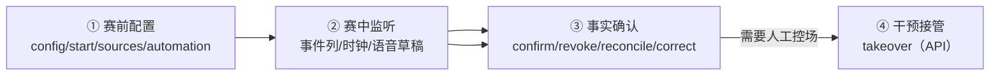

# 26 运营台与导演规范

> 本篇基线：2026-06-07 仓库 a7e5100。

**本篇定位**：运营台（代码目录 `console/`，React 19 + antd 6 + Vite 6，由后端静态托管在 `/console`）的规范篇——运营员在什么界面上照看这套系统、每个界面承诺什么、不承诺什么。本篇写：十页九格的形态与逐格职责（§1）、登录与账号（§2）、导播工作流四步（§3）、事实确认操作（§4）、知识策展台操作（§5）、语音供给切换（§6）、观测页与直播监听（§7）、权限矩阵（§8）。运行侧的值班制度、告警处置与故障响应归 27 篇；页面视觉 token 与客户端页面归 11 篇；协议字段全集归 18 篇。规则 ID 前缀 OPS，引用格式「26/OPS-NN」。

**分工表**：

| 主题 | 本篇落点 | 他篇归属 |
| --- | --- | --- |
| 十页清单、概览九格逐格职责、页面壳 | §1 | 客户端 10 页归 11 篇；页面文案登记归 13 篇 |
| 登录凭证、令牌参数、账号种子 | §2 | 密码哈希与令牌体系工程细节归 22 篇 |
| 导播四步工作流、草稿制、比分纪律 | §3、§4 | 比赛事实账本业务规则归 14 篇；知识业务规则归 15 篇 |
| 话痨档位运营侧只读 | §8（OPS-46） | 用户设置面归 12 篇（SET-04） |
| 观测面板口径与告警阈值 | §7（只写界面承载） | 面板 SQL、告警判断值归 21 篇 |
| 值班排班、告警处置、故障响应 | ——（不在本篇） | 27 篇 |

**导读**：§1 形态：十页九格｜§2 登录与账号｜§3 导播工作流（四步）｜§4 事实确认操作规范｜§5 知识策展台｜§6 语音供给切换｜§7 观测页与直播监听｜§8 权限矩阵与操作纪律｜§9 验收与评测挂钩｜§10 设计说明。

**事实依据**：本篇全部「现网」声明以基线代码为对照源，路由与 scope 逐条按 `console/src/App.tsx` 与后端三张声明式路由表（`console_api.go` 19 条 / `match_operator_api.go` 28 条 / `knowledge_api.go` 4 条，共 51 端点）核对；无代码承载的表述一律写「规划中（未实现）」。

---

## 1. 形态：十页九格

### 1.1 页面全集（十页 + 登录页）

「十页九格」是运营台页面规模的唯一口径。旧资料包 39 章「六格」与 `console/DESIGN.md`「五宫格」均已过期（后者修正属工程侧待办），不再作为任何引用依据。

| # | 路由 | 页面 | 职责一句话 | 读 scope | 写 scope | 承载 FR |
| --- | --- | --- | --- | --- | --- | --- |
| 1 | `/console` | 全局概览 | 九格仪表盘，十秒判断系统健康 | OperatorTraceRead | —（第九格切换见 §6） | FR-OPS-001 |
| 2 | `/console/match/:matchId` | 比赛层 | 单场比赛的事件流、设置、数据源与自动化 | OperatorTraceRead | OperatorMatchWrite | FR-OPS-001 |
| 3 | `/console/match/:matchId/user/:userId` | 用户层 | 代客操作面：画像/话题/交互历史 | OperatorTraceRead | OperatorMatchWrite | FR-OPS-001 |
| 4 | `/console/match/:matchId/director` | 实战导演 | 实时导播：四步草稿流（§3） | OperatorTraceRead | MatchWrite + FactConfirm + FactCorrect | FR-OPS-005 |
| 5 | `/console/threads` | 话题台账 | 开放话题台账与代客收口 | OperatorTraceRead | OperatorMatchWrite | FR-OPS-001 |
| 6 | `/console/operators` | 运营员 | 运营员列表/新建/吊销 | OperatorMatchWrite（读也需写权限，auditor 不可见可管） | OperatorMatchWrite | FR-OPS-012 |
| 7 | `/console/citations` | 引用审计 | 按引用码回查「球球为什么说话」 | OperatorTraceRead | — | FR-OPS-001 |
| 8 | `/console/knowledge` | 知识条目 | 知识策展台（§5） | OperatorTraceRead | OperatorMatchWrite | FR-OPS-001（业务归 15 篇） |
| 9 | `/console/live` | 直播监听 | /ws/ops 只读事件流消费（§7） | OperatorTraceRead（WS 升级鉴权） | — | FR-OPS-006 |
| 10 | `/console/observation` | 观测 | Grafana 双 kiosk 内嵌（§7） | OperatorTraceRead | — | FR-OPS-007 |
| 登录 | `/console/login`（未登录重定向） | 登录页 | 用户名+密码人类通道；个人令牌降级「高级」页签 | 无（认证入口本身） | — | FR-OPS-002 |

- **OPS-01 页面守恒**：新增运营界面一律先在此清单落行并同步 PRD FR-OPS-001，不允许绕过十页清单加挂页面（与 FR-UI-001 同一纪律）。host/takeover 的运营台 UI 落地时按 FR-OPS-010 最小形态并入比赛层操作区，不新开页面。
- **OPS-02 布局壳固定**：侧栏 208px、7 项导航（全局概览/话题台账/引用审计/知识条目/直播监听/观测/运营员）+「实战导演」独立入口；头部 whoami 姓名上屏 + 自助改密 + 退出。暗色唯一主题、表格是页面主角、语义色仅用于状态、危险动作带二次确认。
- **OPS-03 无正文红线**：任何页面、任何一格不允许展示对话正文或用户身份明文——九格、直播监听、观测面板同受此约束（§7）。

### 1.2 概览页九格逐格职责

| 格 | 名称 | 回答的问题 | 数据来源（现网） |
| --- | --- | --- | --- |
| 一 | 活跃比赛 | 现在有哪些比赛在被服务 | 比赛列表 + 状态（赛前/直播中/中场/已结束）+ 在线用户数 |
| 二 | 在线会话 | 有多少用户正连接着 | 在线会话计数，直达话题台账 |
| 三 | 话题老化 | 未答话题积压了多久 | 今日 / 1–3 天 / 3 天+ 三档分布 |
| 四 | 记忆健康 | 记忆管道是否正常 | degraded 徽标 + 写入积压深度 + 最近 5 条记忆审计 |
| 五 | 最近主动引用 | 球球最近为什么主动开口 | 最新主动触达引用码记录，直达引用审计 |
| 六 | 词汇漏斗（没接明白） | 用户的话有多少没被接住 | 24h 路由失纳率 + 最新样本 |
| 七 | 微反应 24h | 伴随反应发出量与白名单事件量是否相称 | 滚动 24h 微反应发出数 vs 白名单事件数 |
| 八 | 客户端语音健康 | 客户端语音链路钟不钟 | `GET /api/console/client-health`（进程内环形缓冲，重启清零；wire 事件裁剪至 kind/at/matchId，无用户身份无正文） |
| 九 | 语音供给三态卡 | 当前 TTS 供给模式与本地腿健康 | `GET /api/console/tts-supply`（§6） |

- 九格里没有互动量、停留时长或转化指标——概览回答「服务现在健康吗、球球说话有没有依据」，不回答「用户有多活跃」（价值面指标归 28 篇）。
- 无数据的一格呈现空态而非报错；九格逐格出数是验收项（§9）。

---

## 2. 登录与账号

### 2.1 人类通道（用户名+密码）

| 规则 | 值 | 反例 |
| --- | --- | --- |
| 通道唯一性 | 人类通道=用户名+密码（ADR-0010）；个人 API 令牌粘贴降级为登录页「高级」页签，供 evals 与脚本使用 | 不允许把个人令牌作为登录页主通道 |
| 凭证哈希 | PBKDF2-SHA256，迭代 100,000——不存明文、不可逆 | 库管理员可读回密码属违规 |
| 令牌对 | 15 分钟 HS256 访问 JWT + 30 天刷新令牌；刷新令牌单次使用（旧行消费即删、库内仅存 SHA-256 hash）、轮换下发 | 刷新令牌重复使用成功属违规 |
| 首登强制改密 | JWT claims 带 PasswordSet：首登临时密码签发的 JWT 无 scope，改密前一切受 scope 保护的路由 403——硬门在令牌层，不在界面层 | 首登临时密码 JWT 携带任何写 scope 属违规 |
| 自助改密 | 旧密码 + 新密码 ≥10 字符；头部 PasswordChangeModal | 绕过旧密码校验改密属违规 |
| 退出 | 吊销当前设备的刷新令牌；401 全局登出回登录页、403 页内提示（两种失败前端处置不同） | 退出后该设备刷新令牌可用属违规 |
| 失败登录 | 写审计（`auth.login_failed`，attempted 名进 object）；v1 不做账号锁定 | 宣称「有账号锁定」为误 |
| 续期 | 访问令牌过期由 API 层凭刷新令牌无感续期重试 | 让运营员手动重登录续期属体验缺陷 |

- **OPS-11 临时密码一次性**：新建运营员产出两份一次性凭据——个人 API 令牌（仅创建时展示一次，之后不可再取）+ 12 字符无歧义字母表随机临时密码（首登强制改密）。「负责人抄给本人」是唯一分发路径，系统不留副本，无找回手段，丢了只能重建。
- **OPS-12 吊销即失效**：吊销（DELETE）删行即失效——令牌校验按请求哈希查表、无缓存会话，下一次请求立刻 401/403，覆盖 /ws/ops、/mcp 全部通道；审计记录保留姓名。
- **OPS-13 显式降级**：无 `DATABASE_URL` 时运营员页与知识条目写路径返回 501 显式降级——不允许把无库环境伪装成正常空列表。

### 2.2 账号种子与引导（默认关）

| 规则 | 值 |
| --- | --- |
| 演示种子开关 | `QIUQIU_DEMO_ACCOUNTS=1` 显式开启 + 仅 development 环境 + 运营员表为空，三条件同时满足才播种；幂等（重复启动不覆盖已有运营员） |
| 演示账号 | admin / 5055365，director 角色；附固定演示令牌（供脚本直连）；密码 setAt 非零——跳过首登强制改密 |
| 默认态 | 缺省环境不产生任何账号——默认关闭 |
| 安全语义联动 | 一旦存在密码账户，legacy 共享令牌通道即被拒绝——演示开关同时也是 legacy 通道的退役开关 |
| 引导通道 | 空表时 `QIUQIU_BOOTSTRAP_OPERATOR`（name:token）可播种第一位 director，凭据只在日志出现一次、库存哈希 |

- **反例**：production 环境播种属违规；非空表时强制重置运营员属违规；演示开关缺省为开属违规。

---

## 3. 导播工作流（四步）

实战导演页（`/console/match/:matchId/director`）是实时运营面唯一入口——operator.html 已于 2026-05-20 退役（ADR-0013），任何文档与链接不再引用它。导演页是旧 39 章「五级暂停/六角色」经 YAGNI 收敛后的形态：**四步草稿流 + 两角色**（ADR-0008）；干预级别设置规划中（未实现，⚖️B4），现网对单场的人工干预只有接管端点（§3.4）。

### 3.1 第一步：赛前配置

| 操作 | 端点（match 面） | scope | 纪律 |
| --- | --- | --- | --- |
| 读比赛配置 | `GET /api/matches/{id}/config` | 公开读（handler 内 authz.view 区分公开/运营视图） | 运营视图多出内部字段，公开视图不泄运营配置 |
| 保存配置 | `POST /api/matches/{id}/config` | OperatorMatchWrite | 整包保存、保存即生效、幂等包裹、实名审计 |
| 双方阵容/比分基线 | 同上（配置载荷内） | OperatorMatchWrite | 球员名单是草稿卡校验的依据（§3.2） |
| 开赛/重置 | `POST /api/matches/{id}/start`、`/reset` | OperatorMatchWrite | reset 属危险动作，二次确认；演示比赛白名单内可一键重置（`isDemoMatchID` 校验，非演示 ID 直接拒绝） |
| 数据源启停 | `POST /api/matches/{id}/sources/start`、`/stop` | OperatorMatchWrite | 回放源（受控演示）与实时源（携比赛 ID 与预期延迟）二选一；无 key 即纯人工模式 |
| 自动化播报策略 | `GET`/`POST /api/matches/{id}/automation` | OperatorMatchWrite | 自动播报总开关 + 播报间冷却 + 允许自动播报的事件范围——选项与行为条 18 类事件同一份词汇表，配置与展示永不脱节 |
| 生命周期 | `POST /api/matches/{id}/lifecycle` | OperatorMatchWrite | 状态推进唯一入口在运营写面 |
| 一键托管 | `POST /api/matches/{id}/host` | OperatorMatchWrite | ESPN summary 填充配置 + 开场 + 挂源（FR-FACT-008 立业务规则；运营台无按钮，UI 规划中） |

### 3.2 第二步：赛中监听

- **OPS-31 行为条只写草稿**：页面上方行为条按组排列 18 类比赛行为（高频：进球/射门/绝佳机会/扑救/错失/犯规；纪律：黄牌/红牌/点球；人员/战术：换人/战术变化/持续压迫/伤停；特殊：VAR检查/VAR结果/进球取消/比分更正/备注），点击任何一类只是把预设写进当前草稿——任何入口都只写草稿，发布永远是一次显式动作，由后端事实账本最终裁决。草稿制是现网写端点中唯一的草稿族（语音草稿与事件发布两族走 `drafts/voice`、`drafts/voice/publish`、`events`、`events/correct`），「18 类运营行为均只生成草稿」的旧表述作废。
- **OPS-32 草稿卡逐槽校验**：事件类型、强度、推荐动作由预设自动填好，人补齐参与者；校验由事件定义驱动（`console/src/director/event-model.ts` 单源）——「换上与换下必须同队」「助攻者必须属于进攻方」「请选择要取消的原进球」「请填写更正原因」，校验不通过草稿发不出去。每条事件载荷带录入时捕获的比赛时钟版本与输入来源（键盘/语音口述），事后每条事实可回答「在哪个时钟版本下、以什么方式录入」。
- **OPS-33 语音草稿**：口述代替点选——`POST drafts/voice` 音频先 ASR 转写再由 LLM 抽取结构化字段（逐字段带置信度），与当前草稿合并时字段冲突逐项进冲突卡、一项项裁决，不静默覆盖；`POST drafts/voice/publish` 走幂等写。ASR 未配置 503、上游故障 502，界面给明确状态——此时键盘录入路径始终可用。转写内容不像赛事口述直接拒绝，不进草稿。
- **OPS-34 时钟治理**：比赛时钟唯一权威在后端，界面 PATCH 校准必须携 expectedVersion；版本不匹配返回 409，前端自动重读最新时钟后操作照常（不弹错误框、不让导播手动刷新）。事件永远不能把主时钟往回拨，阶段切换清零由后端统一执行——界面只是镜子。
- **OPS-35 监听不下场**：赛中监看的默认产出是「等待」——事实未明时保持等待与发布同等可达，不把空白视为失败而急于填充（选择等待的人不需要理由）。实时事件流与投递/播放状态的只读镜像在直播监听页（§7），导演页不重复实现。

### 3.3 第三步：事实确认（细则见 §4）

草稿发布即进入事实时间线的确认/撤销/调和/更正循环——操作规范、比分纪律与幂等键见 §4。

### 3.4 第四步：干预接管

| 项 | 现网 |
| --- | --- |
| 接管端点 | `POST /api/matches/{matchId}/takeover`（OperatorMatchWrite，幂等包裹，接管同时暂停自动播报，避免人和机器各说各话） |
| 运营台 UI | **规划中（未实现）**——十页现无对应按钮，现状调用方式为直连 API（脚本/evals）；落地最小形态=比赛层操作区动作按钮 + 二次确认，不新开页面 |
| 干预级别三档 | **规划中（未实现，⚖️B4）**——旧 39 章「单能力暂停/接管比赛/路由范围收敛」三档及单调性规则无任何代码承载，运营台 director/ 模块群零「干预」字样、后端无 InterventionLevel 实现；不得书写任何干预级别现网参数 |
| 与用户控制的关系 | 用户侧的静音、结束与设置永远优先于运营台的任何配置（权限链 L4 用户设置 > L2 运营策略，见 01 篇）——这条不对称是红线，不是待补功能 |

---

## 4. 事实确认操作规范

事实确认是 ADR-0024 双通道（自动确认 + 运营人工）中「运营人工」一侧的界面承载；自动通道（ESPN 第二源快照 diff + 稳定窗 30 秒）的业务规则归 14 篇，本篇只锁定运营操作面。

### 4.1 五个操作与权限

| 操作 | 端点 | scope | 语义 |
| --- | --- | --- | --- |
| 确认 | `POST /api/matches/{id}/facts/{factId}/confirm` | OperatorFactConfirm | 候选事实达到确认条件，落账本 confirmed |
| 撤销 | `POST /api/matches/{id}/facts/{factId}/revoke` | OperatorFactConfirm | 已发布事实不再作为有效事实；保留线索，不可再被引用；已触发的主动回复被撤回 |
| 调和 | `POST /api/matches/{id}/facts/{factId}/reconcile` | OperatorFactConfirm | 冲突事实的调和推进 |
| 冲突裁决 | `POST /api/matches/{id}/conflicts/{conflictId}/resolve` | OperatorFactConfirm | 多来源冲突单选裁决、必填理由；开放冲突置顶在事实时间线最上，不沉底 |
| 更正 | `POST /api/matches/{id}/events/{eventId}/correct` | OperatorFactCorrect | 已发布事件拉回草稿修改后再次提交；原因必填，随事件入账 |

- 四个公开读端点（`clock/config/events/state` 的 GET）不包 withScope，handler 内以 authz.view 区分公开/运营视图——公开视图不是运营视图的降级副本，是两套投影。

### 4.2 操作纪律

- **OPS-41 幂等键是唯一通行证**：以上全部写操作（含导播语音草稿）统一走 executeOperatorWrite 幂等包裹——请求必带 `Idempotency-Key`（缺键拒绝、键长上限 200）；同键+同载荷哈希返回第一次结果并标 `Idempotency-Replayed: true`；同键+不同载荷判定冲突拒绝；同键执行中后到请求拿到「仍在进行」（2 分钟租约）。前端所有非 GET 请求自动带键，5xx 单次重试与 401 续期重放复用同一把键——同一次点击无论网络抖动多少次，账上只落一条事实。
- **OPS-42 审计留痕**：每笔写操作经 appendAudit 写 `operator_audit` 表（运营员姓名/动作/对象/时间），3 秒独立预算、失败仅记日志不回滚业务不拖慢响应——审计尽力而为，不阻塞运营；任何「成功但无主」的写操作属缺陷。失败登录同入审计。
- **OPS-43 比分四条纪律**（影响面最大的事实单独立规）：① 进球自动 +1 且只加一次——重复确认、重复提交不加成两倍；② 进球取消 Δ=-1 且必须引用原进球，账本拒绝取消从未公开的进球、拒绝重复取消；③ VAR 结果必须引用被审事实，审查中的检查事件以候选存在、不碰公开状态；④ 比分更正强制静默（不触发球球任何主动话术，用户看到比分静静地变对），目标比分须与当前公开比分不同、原因必填。
- **OPS-44 状态即信息质量**：候选（pending）确认前从不参与公开比分投影——裁决前公共状态维持最后确认值，用户端比分不抖；状态名（候选/冲突/已采用/已撤销）体现信息质量而非运营者的自信。
- **OPS-45 更正不是删除痕迹**：更正须让受影响用户能说清「现在以什么为准」；被撤销事件不可在之后的对话中被当作共同经历引用（撤回单向门细则归 21 篇 §2.4）。

---

## 5. 知识策展台

知识条目页（`/console/knowledge`）是知识库的运营操作面；条目结构、门判守卫、双路检索的业务规则归 15 篇，本篇锁定操作流程。端点 4 条：`GET/POST /api/console/knowledge`、`GET/PUT /{entryId}`（读=TraceRead，写=MatchWrite）。

- **OPS-51 条目录入核心五字段**：topics（关键词，至少一个）／answer（正文）／source（来源）／confidence（置信度 ∈[0,1]）／effectiveAt（生效日）。无来源条目过不了表单。另有检索后处理参数学五字段（priority / inclusionGroup / stickyTurns / cooldownTurns / probability）默认值即现状行为，非必填。
- **OPS-52 新建走 slug 校验**：条目 id 小写字母/数字开头、可含连字符、2–64 字符；前后端同一约束，同 id 已存在 409。
- **OPS-53 保存即生效（一键到生产）**：保存写入运营库并全量换血重载，下一问即用新答案——不需要发版、不需要重启、无缓存窗口。仓库内 YAML 自 2026-05-30 条目库 DB 化后降为种子（按 id 幂等导入、已存在跳过），**运营库是唯一可写源**，「改 YAML 即生效」的旧路径已失效。
- **OPS-54 待复查过滤**：转会窗复查制度（ADR-0017）——生效日早于最近窗闭（7 月 1 日 / 1 月 1 日）的档案类条目自动标「待复查」，列表可按 `due=review` 过滤显形提醒，不靠人记。
- **OPS-55 门判联动**：生产门判守卫要求条目库 ≥100（2026-06-07 起门槛自 50 提至 100），跌破即红——策展删除大批条目会撞门挡合入；门判走与生产完全相同的导入路径，能过门=能上线（细则归 15 篇 KNW-12）。
- **反例**：「保存后要重启才生效」的流程不存在；无来源条目不可入库；把种子 YAML 当可写源属违规。

---

## 6. 语音供给切换（TTS 三态）

概览页第九格（TtsSupplyCard）+ `GET/PATCH /api/console/tts-supply` 构成语音供给的运营切换面。

| 规则 | 值 | 反例 |
| --- | --- | --- |
| 三态枚举 | cloud（全云合成）/ local（全本地合成）/ local_first（本地腿优先、异常回落云；回落门控归语音域 20 篇） | 自造第四态属违规 |
| 读 | GET 返回当前模式 + 本地腿健康门控快照 + 回退计数（scope：OperatorTraceRead） | 卡片显示与实际生效模式不一致属缺陷——卡片数据源即配置真源 |
| 写 | PATCH 幂等写 + 持久化入库 + 留审计（scope：OperatorMatchWrite）；重启后供给模式保持，不回默认 | 切换不留审计属违规 |
| 健康门控 | 目标态依赖本地合成而本地腿健康检查未过：PATCH 返回 409 带原因；前端将不可选态置灰并显示原因（置灰只是体验层，门在服务端） | 本地腿未过健康门强切 local/local_first 属违规——供给切换永不盲切 |
| 降级衔接 | 云端 TTS 故障时的降级链（L4）与本地腿（CosyVoice3）形态归 20/21 篇；本篇只锁切换面语义 | 把本页当成语音链路降级的全部属越界表述 |

---

## 7. 观测页与直播监听

### 7.1 观测页（Grafana 只读旁路的界面承载）

- **OPS-71 双 kiosk 内嵌**：观测页以两个 kiosk iframe 内嵌 Grafana 看板 `/d/qiuqiu-ops/?kiosk` 与告警列表 `/alerting/list?kiosk`，地址来自 `/api/console/config`（同源前缀 `/grafana`）；加载后注入 CSS 隐藏 dashboard 控制条。未配置 `QIUQIU_GRAFANA_URL` 时渲染部署指引占位卡，不阻塞其余页面（L8 降级）。
- **OPS-72 只读边界**：Grafana 经只读账号 `qiuqiu_grafana_ro`（仅 SELECT 四张账本表）直查，物理上写不了账本；面板 SQL 只出聚合数字、禁正文列——隐私三层（指标面聚合/单轮回放内嵌既有权限页/实时流序列化前无正文）见 ADR-0021 与 22 篇。Grafana 运行形态（本机 127.0.0.1:3300、不在 compose 内、经后端反代）与 6 面板、4 告警口径归 21/23 篇。
- **OPS-73 只读出口的协议形态**：/mcp 提供 4 个只读账本工具，凭证与运营台同体系（JWT 人类通道或个人令牌机通道），匿名一律 401（刻意不继承 legacy 令牌与开发旁路）、缺只读 scope 403；MCP 无任何写工具（ADR-0022）。工具清单与评测挂钩归 18/24 篇。

### 7.2 直播监听页（/ws/ops 只读流）

- **OPS-74 流的边界**：/ws/ops 是账本 Append 成功后的旁路广播，喂流失败不影响账本；下行 kind 共 **9 类**——`turn_planned / delivery / signal / fact_revision / media_delivery / playback_result / turn_stale / backchannel / character_setting`（与互动账本九类一一对应，见 01 篇 ENF-04）。wire 字段 9 个（type/kind/matchId/userId/traceId/deliveryState/playbackState/latencyMs/at），**正文字段在结构体层面不存在**——无正文不是「约定不填」，是物理没有。
- **OPS-75 鉴权边界**：复用会话鉴权链升级，claims 需 OperatorTraceRead（或 legacy 运营令牌/开发档匿名放行）；用户会话（UserChat）升级成功后立即断开（ClosePolicyViolation）——用户会话订阅运营观测流属违规。
- **OPS-76 消费端纪律**：服务端队列 256、饱和丢弃只计数不阻塞、零订阅同样丢计入、连接 ping 30s；客户端列表上限 200 行、断线重连退避 5s 起指数封顶 30s、暂停=入列冻结（WS 保持、暂停期事件丢弃不缓存——恢复后无重放风暴）、按选中事件 traceId 一键回合回放（WhyDrawer 单轮回放，只内嵌既有权限页）。
- **OPS-77 饱和丢弃无告警**：/ws/ops 饱和丢弃**有意不规则化**（内存计数无落库面，不造代理凑数）——宣称「丢弃率有告警」为误（21 篇 §3.1 同源声明）。
- **OPS-78 观测不窥探**：直播监听的「实时」承诺限于行为流——延迟、状态、轨迹可看，内容永远不可看；「实时监听=能听到用户说话」是红线级误解。

---

## 8. 权限矩阵与操作纪律

### 8.1 六 scope × 操作矩阵

JWT claims 的 scope 全集六项（NFR-SEC-003）：用户面两项 + 运营面四项。运营角色到 scope 的映射是纯函数（`operatorauth.ScopesFor`），未知角色返回空 scope——每条路由 403。

| scope | 值 | 授予谁 | 典型操作 |
| --- | --- | --- | --- |
| 用户会话 | `user:chat` | C 端会话（登录/匿名均发） | 陪看会话收发；运营台不得持有 |
| 用户会话 | `user:read` | C 端会话 | 用户数据读；运营台不得持有 |
| 比赛写入 | `operator:match:write` | director | 比赛配置/启停/数据源/自动化/时钟/事件发布/语音草稿/话题与画像代客写/TTS 切换/运营员管理/host/takeover |
| 事实确认 | `operator:fact:confirm` | director | facts confirm/revoke/reconcile、conflicts resolve |
| 事实更正 | `operator:fact:correct` | director | events correct（更正必填原因） |
| 轨迹读取 | `operator:trace:read` | director + auditor | 概览/事件时间线/话题台账/引用审计/直播监听/观测/知识读/用户层读 |

- **director 持四项运营 scope，auditor 只持 `operator:trace:read`**——auditor 只读不是「少几个按钮」，是 scope 层写权限缺失，越权请求在 withScope 装饰器层被拒（403），界面隐藏写按钮只是第一道门槛。
- 运营台不得持有用户面 scope，用户会话不得持有运营面 scope——两端会话凭证完全不共享。
- scope 为空的端点仅限五类：login（认证入口本身）、whoami 与 me/password（只解析身份）、refresh/logout（凭刷新令牌）。

### 8.2 路由面纪律

- **OPS-81 表即文档**：控制面 51 端点登记在 ServeMux 声明式路由表三张（console 19 / match 28 / knowledge 4），新增端点的唯一合法路径是先在对应路由表加一行（method/pattern/scope/handler）再写 handler；golden 测试锁定三表组合，端点增删必红。表外用户面族（/api/sessions、/api/me、/api/matches/catalog）是 C 端合同，不计入控制面（全集清单归 18 篇）。
- **OPS-82 错误语义**：已知路径+错误方法返回 405（带 Allow 头）；尾部斜杠不再容忍（404）——旧「错误方法 404」记录作废。
- **OPS-83 幂等红门**：新写端点必须接入 executeOperatorWrite 幂等包裹，不允许绕过（NFR-SEC-005；写端点 18 个，其中 2 类走草稿制）。

### 8.3 只读红线（代客操作面）

- **OPS-84 画像只读 + 代客删除**：用户层画像对运营可读不可改；按用户利益删除单个画像槽位需二次确认并记入审计，不支持导出内容——删除的是「球球以为它知道的事」，不是用户对话记录（隐私生命周期归 17/22 篇）。
- **OPS-85 话题台账可收口**：运营可把超时未答话题标记为已答/过期（PATCH），让台账反映真实状态；auditor 只能看。
- **OPS-86 话痨档位刻意只读**：用户在客户端选择的话痨三档在运营台无写入口——档位是用户权利（01 篇权限链 L4>L2），这条不对称是设计而非省事（用户侧见 12 篇 SET-04）。
- **OPS-87 交互历史如实呈现**：用户层交互历史按时间列出回合与投递状态，用于回答「刚才发生了什么」，不用于评价用户；无任何私人对话原文检索入口。

---

## 9. 验收与评测挂钩

| 规则/机制 | 挂钩评测 | 闸门位置 |
| --- | --- | --- |
| 十页可导航、鉴权守卫、页面契约 | E2E console-pages.spec.mjs（六页面覆盖）+ console-identity / console-threads / console-live / console-auth / console-director(/baseline) | pr 档 |
| 导播请求形状与草稿纪律 | operator-control.spec.mjs（28 例：登录、scope 门控、草稿状态机、比分纪律、幂等重放、时钟 409 自愈、审计落行——请求形状与断言逐字一致） | pr 档 |
| 知识策展台 | console vitest Knowledge.test.tsx + 录入消费验证（显式开关，15 篇 §5） | pr 档 / 按需 |
| 前端组件与 API 层 | console vitest 三件（TurnReplay / useAsync / Knowledge），jsdom | pr 档 |
| 路由表组合与 scope 列 | console_golden_test.go（端点增删必红）；operatorauth/operatorwrite 包单测（scope 映射、删行即失效、幂等键/载荷冲突/busy 租约） | go test |
| 登录链路 | consoleauth 包单测（TTL 15min/30d、PBKDF2 100k、刷新轮换、首登无 scope）；demo_accounts 单测（三条件与幂等） | go test |
| tts-supply 切换 | ttssupply 包单测（三态/409 门控/持久化） | go test |
| /ws/ops 流 | 后端 ops stream 单测（饱和丢弃计数、鉴权四路） | go test |

验收红线：九格中任何一格出现对话正文或用户身份明文；auditor 令牌写请求非 403；同 Idempotency-Key 重放产生二次效果；引用 operator.html 及其链接；为导播台书写任何干预级别现网参数——以上任一出现即违规。

---

## 10. 设计说明

1. **与迁移源（v2 39/54 章）的差异**：本篇是两章的合并重写，四处结构性翻转——① 概览六格→**九格**（微反应 24h、客户端语音健康、语音供给三态卡三格为 05-22 后新增）；② 旧单页 operator.html **退役**（ADR-0013，2026-05-20），实时运营面唯一入口收敛为 /console 导演页，跨页幂等键分裂、双凭证、状态分歧三类并存期成本随之消失；③ 「五级暂停/六角色」收敛为**四步草稿流+两角色**（ADR-0008），干预级别三档按 F1 处置降级为规划中（未实现，⚖️B4）；④ 「18 类运营行为均只生成草稿」改写为**写端点 18 个、其中 2 类走草稿制**（F12）——事实确认类操作幂等直接生效。
2. **「快而不乱」的结构答案**：发布前不设审批卡、不设双人复核（进球窗口只有几十秒，迟到的「好球」不如不说）；替代物是草稿制+账本裁决+幂等键+实名审计四件结构物——错误进不了公开事实、重复落不进账本、每一步都能归到人。可追溯性由审计轨迹兜底而不是由第二个人兜底；若未来多场次并行值守，双人复核是第一个值得重估的项。
3. **为什么管理员页 GET 也要写 scope**：运营员列表暴露账号面，auditor 无需也不应看到；`operator:match:write` 成为「运营管理权」的事实门槛。这是矩阵里唯一一处「读比写更严」的端点族，属有意设计。
4. **组件标签单源**：运营台界面字符串（如比赛设置页 SOURCE_TYPE_LABELS、三态卡与知识状态标签）单源在各组件/`api/*.ts` 内并进 vitest 断言；语气纪律（准确、中性、可操作）归 13 篇 copy sheet。`console/DESIGN.md` 的「五宫格」与页面清单描述已过期（现网九格+五面缺失），修正属工程侧待办；其设计 token 层（色板/antd token/Sider 208px）经核仍准确。
5. **观测页为什么是内嵌而不是跳转**：同源反代 + kiosk iframe 让值班者在运营台内完成「告警响起→看面板」的闭环，不管理第二套登录；CSS 注入隐藏控制条是防误改 provisioning 的界面纪律。auth-proxy 统一鉴权与 Grafana compose 化属部署轮后置项（ADR-0021），不写成已交付。
6. **UI 缺口如实登记**：host/takeover 有 API 无按钮（FR-OPS-010）、干预级别无实现（⚖️B4）——本篇按「界面不做没有路由支撑的承诺」纪律处理：只登记缺口，不虚设按钮、不虚构参数。
7. **文体说明**：本篇为 reference 查表体；v2 39 章「五条运营原则」的论证文字（等待是合法产出、更正不是删除痕迹、导播台不是上帝视角）已分别沉入 OPS-35/OPS-45/§8.3 红线条目与反例列，不再以散文重复。

---

## 修订记录

| 版本 | 日期 | 依据 | 变更摘要 |
| --- | --- | --- | --- |
| v3.0 | 2026-06-08 | PRD v3.0 第四章 4.10（FR-OPS-001～012）、第五章 5.3；ADR-0008/0010/0013/0021/0022/0024；迁移源 v2 档案 39/54 章 | 初版。立十页九格形态（逐页职责/入口/scope/承载 FR）、登录与账号（JWT 人类通道/PBKDF2/一次性凭据/演示种子默认关）、导播四步工作流（赛前配置/赛中监听/事实确认/干预接管）、事实确认五操作与比分四纪律、知识策展台五字段与一键到生产、TTS 三态切换与 409 健康门控、观测页与 /ws/ops 九类边界、六 scope 权限矩阵与只读红线；验收红线与设计说明七条 |
