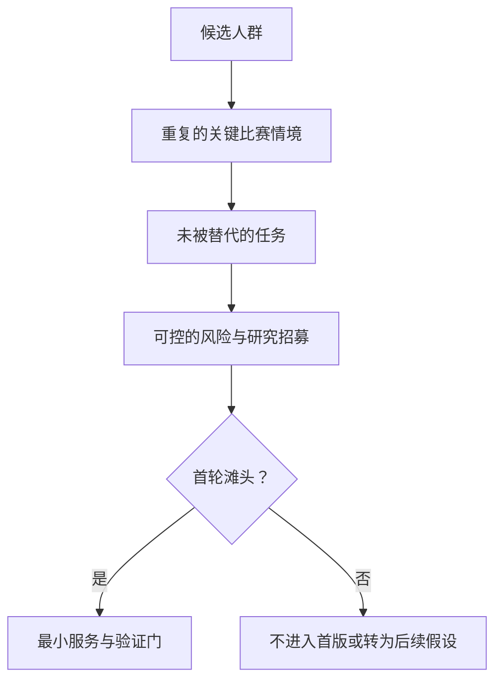
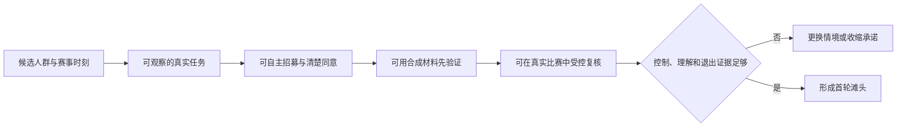
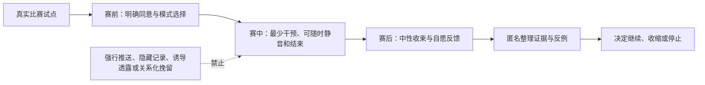

# 首批用户与滩头场景

> 球球 · 用户与价值定义。本文说明我们如何挑选第一批服务的人、第一类比赛和第一个要被验证的承诺：怎样给候选场景打分、选哪几场比赛、找什么人、按什么顺序验证，以及在什么情况下收缩或停止。文中所有评分、样本量与门槛都是立项前的规划假设——我们尚未执行其中的任何一轮研究或试点；"首选""通过"指的都是下一轮待验证的决策，不是已被市场证明的结论。

## 1. 要解决的不是“找更多球迷”，而是找到第一个必须被解决的时刻

一款面向足球观看的数字球友（Digital Ballmate）陪看服务，很容易把目标写成“足球爱好者”或“喜欢数字人的年轻用户”。这两类说法都不足以指导 0→1 阶段的选择：它们没有说明用户在哪一刻感到阻塞，正在用什么替代办法，愿意为了什么改变原有习惯，也没有说明产品该在何时安静。

我们把“滩头场景”定义为：**一小群边界清楚的成年用户，在一种可重复的比赛观看情境中，已经有可观察的未满足任务；我们可以用有限的服务范围验证价值、控制感、可信度和安全边界。** 它不是市场最大的人群，也不是最容易被广告触达的人群，更不是最愿意长时间聊天的人群。

选择滩头的目标有四个。

1. 用一个足够窄的情境，避免把比分、资讯、社区、泛陪聊、主播和数字人表演同时做成首版目标。
2. 把“陪看是否有价值”变成可观察的任务完成，而不是用好感、头像喜欢度或聊天时长替代价值。
3. 在真实比赛的时序、情绪和注意力竞争中，优先暴露剧透、打扰、事实失真、过度拟人和权限不清等风险。
4. 给后续扩张留下清楚条件：哪项假设成立才扩赛事，哪项成立才加语音，哪项成立才开放更多主动介入。

首版需要回答的核心问题不是“用户会不会和数字球友聊天”，而是：**当用户独自或低社交压力地看一场在意的比赛时，是否愿意保留一个低频、可拒绝、可信且不会抢走比赛注意力的陪看入口？** 如果这个问题不能被正面验证，我们不应因为角色效果、内容数量或下载量而扩大范围。

## 2. 决策原则与非目标

### 2.1 四个不能交换的原则

**先验证情境，再定义人群。** 同一个人可能在主队淘汰赛时希望低频文字陪看，在朋友聚会时完全不需要服务，在补看集锦时只想要结果。因此，“成年、常看球、愿意使用 AI”只能用于招募筛选，不能直接推出功能优先级。

**先证明可退出，再证明可陪伴。** 用户能否安静地离开，是比“角色能否连续回应”更早的验收项；静音、切回纯文字、结束本场、撤回许可这套控制承诺的完整形态，以《产品全貌》为准。退出路径一旦含糊，任何互动数据都可能混入被打扰、被困住或不知道如何关闭的成分。

**先证明可信，再证明有温度。** 在比分、伤停、判罚和赛果等高敏感信息上，事实状态、观看进度和不确定性表达必须先于情绪化回应。一个温暖但剧透或自信说错的陪看角色，会比一个安静的信息入口更快失去信任。

**先把脆弱场景排除，再讨论增长。** 未成年人、明显危机表达、被强迫参与、无法理解同意内容的人群，不应作为首批招募和增长目标。对陪伴型 AI 的角色、商业化、数据处理、未成年人和负面影响监测，监管部门已提出明确关注（见文末来源）。0→1 阶段宁可放弃样本规模，也不能用不具备保护条件的参与来换取“真实感”。

### 2.2 非目标

下列事情不属于首批滩头验证的成功条件：

- 证明所有足球观众都需要数字陪看；
- 证明用户愿意接受全天候泛陪聊；
- 以关系等级、连续签到、深夜召回或失利后的情绪表达提高留存；
- 通过未经许可的实时提醒争取打开率；
- 用单次问卷喜欢度推断长期付费意愿；
- 将研究参与误导为心理支持、社交替代或专业体育解说服务。

这些非目标不是保守措辞，而是滩头选择的边界。若首版需要依靠其中任一手段才能让用户留下，说明价值假设并未成立。

## 3. 滩头选择框架：从“可触达”走向“值得被服务”

### 3.1 五个评分维度

候选滩头必须同时经过需求、场景、可验证性、风险和扩张五类判断。评分采用 1 至 5 分：1 表示暂不具备进入首批研究的条件，3 表示可以研究但风险或不确定性较高，5 表示适合被放进首轮验证。分数只是强迫我们说清假设的工具，不能被误用为市场事实。

- **维度：情境痛点强度**
  - **权重**：25%
  - **需要回答的问题**：用户是否能描述一个近期发生、已有替代方案却仍不满意的观看时刻？
  - **1 分意味着什么**：需求只有抽象兴趣
  - **5 分意味着什么**：任务反复出现，且现有替代存在明确缺口

- **维度：服务契合度**
  - **权重**：20%
  - **需要回答的问题**：低频、可拒绝的数字陪看是否比资讯或群聊更适合解决问题？
  - **1 分意味着什么**：纯比分或搜索已足够
  - **5 分意味着什么**：需要事实、解释与低负担回应的组合

- **维度：可控验证性**
  - **权重**：20%
  - **需要回答的问题**：是否能在可重复的赛前、赛中、赛后流程中观察价值和失败？
  - **1 分意味着什么**：只能靠长期想象
  - **5 分意味着什么**：可用原型、预录内容和真实比赛逐级验证

- **维度：风险可管理性**
  - **权重**：20%
  - **需要回答的问题**：时序、隐私、情感边界、年龄与招募风险是否能被清楚限制？
  - **1 分意味着什么**：风险未知或无法处置
  - **5 分意味着什么**：可明确同意、退出、数据最小化和停止机制

- **维度：可扩张邻近性**
  - **权重**：15%
  - **需要回答的问题**：假设成立后，是否能自然扩展到相邻赛事、媒介或人群？
  - **1 分意味着什么**：成功仅适用于极端偶发情境
  - **5 分意味着什么**：有可验证的相邻场景，而不稀释核心价值

加权总分不是自动决策器。任何候选只要在“风险可管理性”得分低于 3，或触及剧透、未经同意的音频、排他关系表达、未成年人保护不足等红线，即使总分最高也不得进入真实比赛试点。

### 3.2 选择时要问的反事实问题

每一个候选人群都必须通过三道反事实提问：

1. **如果没有数字角色，只提供可信的短摘要，用户的任务是否已被完全解决？** 若答案为是，先验证信息服务，不应把数字球友作为前提。
2. **如果没有主动介入，用户是否仍能感知到价值？** 若答案为否，说明设计可能依赖打扰而不是价值，必须先验证主动触发的许可与主动沉默的设计。
3. **如果用户不愿保存任何个人偏好，体验是否仍然成立？** 若答案为否，说明首版过度依赖数据收集，应收缩服务范围。

这三问帮助我们区分“数字人很吸引人”与“数字陪看确实解决了一个不可替代的任务”。前者可以带来一次点击，后者才值得投入产品、内容和工程能力。

### 3.3 候选人群以观看情境为单位

我们以观看情境而不是永久标签来描述候选人群：独自或低社交压力观看重要比赛的成年球迷、断续观看需要快速接回上下文的用户、想看懂比赛但抗拒被教学的轻度进入者，以及已有高频社交观看方式的核心球迷（暂作对照而非首选）。其中，独看、轻度与排除人群见《核心用户分层与使用情境》，断续观看见《观赛旅程与用户情境》原型 B，本文不再重复。

## 4. 候选赛事：选择可观察的比赛，而不是只追逐最高热度

比赛类型决定了用户情绪、观看时序、招募难度、数据来源一致性和风险暴露。首轮应覆盖差异，而不是把所有资源投向同一种大赛。

- **候选赛事类型：主队常规联赛直播**
  - **可验证的核心问题**：低频陪看是否能融入重复习惯
  - **优点**：可重复、便于观察回访与调整
  - **主要风险**：重要度不稳定，用户可能只关心比分
  - **首轮建议**：作为基础样本，覆盖 2 至 3 场

- **候选赛事类型：国内外杯赛淘汰阶段**
  - **可验证的核心问题**：情绪峰值、争议事件和赛后收束是否可控
  - **优点**：价值与风险都更明显
  - **主要风险**：剧透、情绪化表达和事实误判代价更高
  - **首轮建议**：只在控制机制通过预录验证后加入

- **候选赛事类型：德比或争冠/保级关键战**
  - **可验证的核心问题**：高投入用户是否仍愿意接受克制介入
  - **优点**：最能验证“少说但说对”
  - **主要风险**：对立、辱骂、过度兴奋和失利情绪
  - **首轮建议**：作为压力场景，不作为首场试点

- **候选赛事类型：国家队或大型赛事**
  - **可验证的核心问题**：低熟悉度用户的解释需求是否存在
  - **优点**：有机会覆盖想看懂比赛的轻度进入者
  - **主要风险**：流量大、赛程集中、风险放大
  - **首轮建议**：只做受控小样本，不做公开扩张

- **候选赛事类型：延迟观看或集锦回看**
  - **可验证的核心问题**：观看进度控制是否可信
  - **优点**：能隔离时序和剧透问题
  - **主要风险**：容易被不恰当提醒破坏
  - **首轮建议**：适合预录实验和文字路径验证

- **候选赛事类型：低关注度常规比赛**
  - **可验证的核心问题**：产品能否在非情绪高峰仍有价值
  - **优点**：便于识别是否只靠大赛刺激
  - **主要风险**：任务弱，容易得到假阴性
  - **首轮建议**：不作为首轮主战场，可用于对照

### 4.1 赛事选择的三条硬门槛

进入真实比赛试点的赛事必须同时满足：

1. **观看进度能被参与者自主设置或确认。** 无法确认时，默认不主动推送关键事件。
2. **参与者拥有稳定、合法的观看途径。** 研究不引导、不提供也不鼓励任何未经授权的赛事传播方式。
3. **研究团队有明确的赛中停止权。** 一旦出现高严重度剧透、事实误导、边界越界、未经许可的声音播放或参与者要求退出，应停止该场相关流程，不等待“收集完样本”。

### 4.2 首轮赛事组合假设

建议采用“二常规、一压力、一回看”的组合，而不是只选一场最热门比赛：两场主队常规联赛直播用于观察可重复任务；一场高重要度淘汰或关键战用于检验边界与情绪压力；一段经授权的预录比赛材料用于在可控条件下检验延迟和剧透。这个组合不是为了制造统计代表性，而是为了在有限样本中故意寻找反例。

## 5. 候选招募渠道：渠道本身也是偏差来源

渠道不只决定“能否找到人”，还决定谁被排除、谁更愿意迎合研究者、谁会把服务误解为粉丝福利或社群身份。招募设计必须把渠道偏差写在方案里，而不是在结果出来后才补一句局限。

- **渠道类型：合法赛事内容社区与公开兴趣社群**
  - **更容易触达的人**：愿意表达观赛习惯的成年人
  - **适合验证什么**：独自观看与断续观看两类情境的语言与招募筛选
  - **容易带来的偏差**：高频发言者、意见强者过多
  - **使用规则**：不以管理员压力招募；避免公开收集私人故事

- **渠道类型：球迷会、线下观赛组织与朋友转介**
  - **更容易触达的人**：有稳定主队关注的人
  - **适合验证什么**：主队赛事与重复观看场景
  - **容易带来的偏差**：社交同质性强，易把群体观点当普遍需求
  - **使用规则**：每个转介链设置上限，保留独立样本

- **渠道类型：用户研究招募平台或研究机构样本库**
  - **更容易触达的人**：可以按年龄、观看方式与媒介条件配额
  - **适合验证什么**：对照样本、可用性研究
  - **容易带来的偏差**：参与研究熟练者可能多
  - **使用规则**：用行为筛选替代“自称球迷”

- **渠道类型：高校、职场或兴趣社团的公开招募**
  - **更容易触达的人**：低熟悉度但愿意观看者
  - **适合验证什么**：轻度进入者的解释需求
  - **容易带来的偏差**：年龄、时间与设备条件集中
  - **使用规则**：不在有上下级关系的场合直接招募

- **渠道类型：无障碍与辅助技术相关公开社群**
  - **更容易触达的人**：有明确媒介与操作需求的成年人
  - **适合验证什么**：文字、字幕、动效与控制路径
  - **容易带来的偏差**：样本量小，不能被当作单一“特殊用户”
  - **使用规则**：先征求社群意见，提供等额补偿与可访问材料

- **渠道类型：付费投放或泛娱乐流量渠道**
  - **更容易触达的人**：容易扩大触达
  - **适合验证什么**：只适合后续渠道假设
  - **容易带来的偏差**：可能吸引对足球任务并不明确的人
  - **使用规则**：首轮不作为主渠道，避免把点击误当需求

首轮建议组合为：约 40% 来自合法足球兴趣渠道，30% 来自研究样本库，20% 来自独立转介，10% 来自无障碍或低熟悉度定向招募。比例不是配额真理，而是防止任何单一社群定义全部用户语言。若某渠道带来大量“只是喜欢尝鲜、没有近期观看任务”的报名者，应降低其权重。

## 6. 初始评分矩阵与暂定选择

以下分数均为立项假设，由研究、产品与安全负责人在招募前共同填写。它们只反映“值得先研究”的优先级，不代表真实市场评分。

### 6.1 人群-情境评分矩阵

- **候选：独自或低社交压力观看重要比赛者**
  - **痛点强度 25**：4
  - **服务契合 20**：4
  - **可控验证 20**：4
  - **风险管理 20**：3
  - **邻近扩张 15**：4
  - **加权总分 / 5**：3.80
  - **首轮结论**：**首选，但先通过边界与时序门槛**

- **候选：断续观看、需要接回上下文者**
  - **痛点强度 25**：4
  - **服务契合 20**：3
  - **可控验证 20**：5
  - **风险管理 20**：4
  - **邻近扩张 15**：4
  - **加权总分 / 5**：4.05
  - **首轮结论**：**首选，用作低风险价值基线**

- **候选：想看懂比赛但不想被教学的轻度进入者**
  - **痛点强度 25**：3
  - **服务契合 20**：3
  - **可控验证 20**：4
  - **风险管理 20**：4
  - **邻近扩张 15**：3
  - **加权总分 / 5**：3.40
  - **首轮结论**：第二批，先验证解释而非人格化

- **候选：高社交核心球迷**
  - **痛点强度 25**：2
  - **服务契合 20**：2
  - **可控验证 20**：3
  - **风险管理 20**：3
  - **邻近扩张 15**：4
  - **加权总分 / 5**：2.70
  - **首轮结论**：暂缓，作为替代方案对照

矩阵看似让断续观看情境得分更高，但独自观看重要比赛仍应保留为关键首批场景：断续观看情境能证明摘要和恢复上下文是否有用，独自观看重要比赛才能证明“数字陪看”是否在严格边界下成立。正确做法不是二选一，而是让断续观看成为价值与控制的基线，让独自观看成为陪伴与风险的压力验证。

### 6.2 赛事-渠道评分矩阵

- **组合：常规联赛直播 × 研究样本库**
  - **招募可行性**：4
  - **时序可控性**：4
  - **任务可观察性**：4
  - **风险暴露价值**：3
  - **可重复性**：5
  - **首轮优先级**：高

- **组合：常规联赛直播 × 兴趣社群**
  - **招募可行性**：4
  - **时序可控性**：3
  - **任务可观察性**：4
  - **风险暴露价值**：3
  - **可重复性**：4
  - **首轮优先级**：高

- **组合：预录回看 × 多渠道混合样本**
  - **招募可行性**：5
  - **时序可控性**：5
  - **任务可观察性**：5
  - **风险暴露价值**：3
  - **可重复性**：4
  - **首轮优先级**：很高

- **组合：高重要度淘汰赛 × 已完成前测的参与者**
  - **招募可行性**：3
  - **时序可控性**：2
  - **任务可观察性**：5
  - **风险暴露价值**：5
  - **可重复性**：3
  - **首轮优先级**：中，需后置

- **组合：大型赛事 × 泛投放新用户**
  - **招募可行性**：5
  - **时序可控性**：1
  - **任务可观察性**：3
  - **风险暴露价值**：5
  - **可重复性**：3
  - **首轮优先级**：暂缓

**暂定滩头结论。** 首批验证应聚焦两类成年人：断续观看、需要快速接回上下文者，以及独自或低社交压力观看重要比赛者。服务先以文字优先、用户主动提问优先、短摘要和明确控制为核心；真实高重要度比赛只在预录验证通过后进入。想看懂比赛的轻度进入者作为第二批解释场景，高社交核心球迷作为替代工具对照，而不是增长主战场。

## 7. 首批服务假设：用户愿意带进比赛的最小闭环

### 7.1 待办任务与最低服务承诺

首批滩头不需要一个永远热闹的角色，而需要一个在该说话时刚好热闹、在用户想专心看球时彻底安静的最小闭环：

1. 用户在赛前明确选择本场比赛、观看进度、文字或声音、互动强度和是否允许关键事件提示。
2. 用户在赛中能够主动问一个事实、规则或事件影响问题；回答把已确认事实、不确定信息和解释性观点分开。
3. 用户离开后能够选择一份与自己进度一致的短摘要，或只看比分，不被默认剧透。
4. 用户在任何时刻都握有清晰的退出路径，静音、降频、结束本场不打折扣——完整控制承诺见《产品全貌》。
5. 用户赛后可选择一段短回顾、完全不保存，或查看并撤回一项非必要偏好许可。

### 7.2 首版暂不承诺的能力

为了避免首批验证被“功能很多”掩盖，以下能力应明确后置：连续主动语音陪聊；无边界日常聊天；关系积分或亲密等级；自动跨场记忆；未经逐项授权的个性化推荐；多人房间或陌生人社交；针对失利、孤独、深夜等情绪高峰的转化；面向未成年人的陪伴体验。后置不等于永远不做，而是要求每一项先获得独立的需求、风险和控制权证据。

## 8. 招募与样本设计：用足够的差异寻找反例，而不是伪造精确比例

### 8.1 三层样本计划

定性研究的样本量应服务于“发现模式、反例与设计失败”，而不是在小样本上宣称市场比例。GOV.UK 的用户研究指南强调持续、迭代地与真实用户研究，而非把一次研究当作结论终点；Nielsen Norman Group 对可用性研究也指出，小批量、连续轮次比一次性堆叠大量参与者更有效，但具体人数仍应由任务风险和参与者差异决定（见文末来源）。

- **阶段：探索访谈与旅程回溯**
  - **样本建议**：24 至 30 名成年人
  - **目的**：确认任务语言、替代方案和拒绝点
  - **必须覆盖的差异**：三类候选情境、直播/回看、独自/社交、文字/语音偏好
  - **不应得出的结论**：不推算人群规模与付费比例

- **阶段：预录原型验证**
  - **样本建议**：18 至 24 名成年人，分 3 至 4 轮
  - **目的**：验证时序、事实状态、静音与退出
  - **必须覆盖的差异**：低熟悉度、公共场所静音、不同阅读速度和辅助需求
  - **不应得出的结论**：不推断真实比赛留存

- **阶段：真实比赛小范围试点**
  - **样本建议**：36 至 48 名已完成前测的成年人，分 3 至 5 场
  - **目的**：验证注意力竞争、延迟、情绪和赛后抽离
  - **必须覆盖的差异**：常规赛、关键赛、断续观看、两类核心情境
  - **不应得出的结论**：不用小样本证明可规模化增长

样本增加条件应由“新问题是否仍出现”决定。若第 20 位访谈者仍不断提出未覆盖的替代方案或边界担忧，应增加有目的的样本，而不是机械地宣布饱和。反过来，如果连续两轮同类参与者都能完成关键任务，且没有新的高严重度问题，可以把资源转向不同媒介或不同赛事条件。

### 8.2 招募筛选问题

筛选不应直接问“你会不会喜欢数字人”，因为这会把对新技术的好奇误当成陪看需求。建议使用近期行为问题：

- 过去八周内，你观看、跟随或回看过几场足球比赛？请描述最近一次的比赛类型与观看方式。
- 最近一次你中途离开比赛后，如何补上进度？用了哪些渠道，哪里不满意？
- 在重要比赛中，你通常独自看、与熟人看、在群聊中看，还是在公共场所断续看？
- 你是否曾因害怕剧透而关闭提醒、避开社媒或要求别人不要说结果？
- 你是否愿意在研究中使用文字优先的原型？是否需要字幕、大字号、减少动效、键盘操作或其他可访问安排？
- 你是否年满法定成人年龄，且能独立决定是否参与和退出？

不要在筛选表中收集精确住址、真实社交账号、与研究无关的健康史、完整聊天记录、身份证件号码或不必要的生物特征。若研究确实需要年龄核验或补偿信息，应将其与行为研究资料分开处理，并在招募说明中写明目的、保留期和删除方式。

### 8.3 配额不是刻板标签

建议至少设四条软配额：一半左右有断续观看经历；一半左右在重要比赛中会独自或低社交压力观看；至少三分之一不自认“懂战术”；至少四分之一明确要求静音、文字或其他可访问路径。配额的目的是打破“高频男性核心球迷等于全部用户”的方便想象，而不是要求研究参与者透露敏感身份或将性别、地域、职业当作能力代理变量。

## 9. 预录验证设计：先在可控时序里证明不会伤害观看体验

### 9.1 为什么预录在前

真实直播的复杂性很高：观看进度不同、网络延迟不同、用户随时离开、裁判与转播信息可能变化、情绪又处于高点。若一开始就在真实比赛中验证，我们很难判断失败来自概念、交互、事实状态、媒介还是外部时序。预录验证不是替代真实比赛，而是先隔离变量，避免把可预见的剧透和打扰交给参与者承担。

### 9.2 材料与场景

使用已获得适当授权、可用于研究演示的比赛片段或中性模拟材料，制作三类长度为 8 至 15 分钟的场景包：

1. **中断后返回**：参与者在关键事件前离开，再以不同观看进度返回，比较“只看比分”“确认事件”“带一句解释”的摘要。
2. **争议或待确认事件**：材料中包含需要等待确认的信息，观察参与者能否分清已确认、待确认与解释观点。
3. **公共场所与静音**：参与者在无声音条件下完成进入、提问、关闭主动内容、恢复文字摘要和退出。

每个场景都应有一份“研究者不可见的预期路径”和一份“参与者可见的中性任务卡”。任务卡不提示正确按钮位置，也不暗示研究者期待用户选择互动。研究者记录的是犹豫、误解、恢复能力和语言反应，不是诱导用户多说几句。

### 9.3 核心任务与通过门槛

**任务：选择本场模式**
- **参与者应完成的动作**：在 30 秒内选择文字低频，并找到如何恢复
- **通过门槛**：80% 以上无需提示完成
- **高严重度失败**：用户不知道声音会自动播放或不知道如何停止

**任务：回到比赛**
- **参与者应完成的动作**：选择与自己进度一致的摘要
- **通过门槛**：80% 以上理解信息范围
- **高严重度失败**：任何用户被展示自己尚未观看的关键结果

**任务：处理不确定事件**
- **参与者应完成的动作**：区分事实、待确认状态与解释
- **通过门槛**：80% 以上正确复述
- **高严重度失败**：用户把推测理解为确定赛况

**任务：主动提问后退出**
- **参与者应完成的动作**：获得短解释、随后安静结束
- **通过门槛**：80% 以上能独立完成
- **高严重度失败**：退出被挽留话术、二次确认或隐藏入口阻拦

**任务：管理许可**
- **参与者应完成的动作**：找到一项偏好并选择不保存或撤回
- **通过门槛**：80% 以上能解释后果
- **高严重度失败**：用户不知道系统会保存什么或无法撤回

80% 是首轮可用性信号，不是法律或统计上的充分条件。任何高严重度失败都具有一票否决权：先修复并重新验证，不以总体平均完成率抵消。

## 10. 真实比赛试点：验证真实注意力，而非追求热闹数据

### 10.1 进入条件

只有当预录验证的高严重度问题清零，并且参与者能理解模式、事实状态、静音与退出后，才进入真实比赛。每位参与者应在赛前再次确认：比赛、观看方式、主动内容范围、是否允许声音、何时可能收到内容、如何退出、研究记录什么以及如何联系研究人员。

真实比赛试点采用“小批次、可暂停、逐场复盘”的方法。第一场只招募 8 至 12 名已完成预录研究的成年人，重点看时序和退出；之后每场增加前，先审查上一场的高严重度问题、投诉、剧透反馈、设置理解错误和研究者观察。不要用“还差样本数”推翻停止权。

### 10.2 赛前、赛中、赛后流程

**时点：赛前 24 小时内**
- **研究动作**：发送中性提醒和研究说明复核
- **用户控制**：可无理由取消，不影响补偿
- **需要观察的信号**：是否理解本场服务边界

**时点：开赛前**
- **研究动作**：确认观看进度、媒介、频率、许可
- **用户控制**：默认文字低频；可选完全静默
- **需要观察的信号**：是否能独立设置并解释选择

**时点：赛中**
- **研究动作**：只记录必要的任务完成与严重问题
- **用户控制**：随时静音、退出、暂停研究记录
- **需要观察的信号**：是否被打扰、是否发生时序误解

**时点：终场后立即**
- **研究动作**：3 至 5 题极短回顾
- **用户控制**：可跳过所有主观问题
- **需要观察的信号**：是否感到被支持但未被占用

**时点：24 小时内**
- **研究动作**：自愿回访，回溯关键时刻
- **用户控制**：可拒绝录音与引述
- **需要观察的信号**：用户是否还记得控制方式、是否愿再次使用

**时点：研究结束**
- **研究动作**：兑现补偿、说明材料处理和删除渠道
- **用户控制**：可请求删除其可识别研究资料
- **需要观察的信号**：删除与退出是否清晰可信

### 10.3 真实比赛中禁止的研究做法

- 不在用户情绪高峰时要求完成长问卷、录制自拍视频或分享私人群聊；
- 不用“你不回复角色会难过”“帮它完成陪看任务”等拟人化提示提高参与率，也不因参与者选择静音、退出或拒绝记忆许可而降低补偿；
- 不用连续打开、对话轮数或情绪披露换取额外补偿；
- 不把实时研究通知伪装成普通赛事提醒；
- 不在未完成保护流程前招募未成年人或将脆弱情绪作为筛选优势。

## 11. 研究伦理、数据边界与参与者尊重

### 11.1 知情同意要能被理解，不只是被勾选

首轮只招募能够自主理解研究说明并给予知情同意的成年人；处于心理或情绪危机中、被雇主或家人要求参与、无法独立退出，或希望把数字球友当作现实关系替代的人，不进入研究。排除不是对任何人的价值判断，而是承认首版尚未具备相应的保护与处置能力。

同意材料至少用日常语言回答六个问题：研究想了解什么；参与者需要做什么；会记录哪些资料；哪些资料不会收集；可以在什么时候退出；出现不舒服、误解或投诉时找谁。若服务涉及语音、文字转写、偏好保存或角色化表达，应分项说明，不能把多个高影响授权塞进一个总开关。

《个人信息保护法》确立了处理个人信息应具有明确、合理目的并遵循最小必要原则等要求。我们不提供法律意见，但把最小化、分项授权、可撤回、可查询和明确保留期作为研究设计的最低基线；面向公众的生成式人工智能服务还需关注内容安全、未成年人保护、投诉处理和标识等要求（见文末来源）。

### 11.2 补偿与自愿性

补偿应覆盖参与者投入的时间、流量、交通或无障碍安排成本，而不是奖励更长对话或更私密披露。补偿金额和发放条件在招募时写清；完成核心研究流程或因不适退出的参与者，都应得到公平补偿。若使用抽奖、优惠券或产品权益，必须避免让参与者误以为不开放敏感数据、不开声音或不继续参加就会失去基本补偿。

### 11.3 不把“陪伴”当作研究关系

研究人员和数字球友都不应承诺长期陪伴、保密友谊、现实替代或情绪疗愈。若参与者表达强烈痛苦、危机或依赖倾向，研究流程应停止角色化互动，使用预先准备、经专业审查的安全与求助信息，并由具备权限的责任人处理。研究人员不是医疗或心理服务提供者；最重要的动作是尊重退出、避免错误承诺和避免继续把参与者留在互动中。

## 12. 成功、失败与停止信号

### 12.1 首轮成功不是“用得更久”

成功必须同时拿到四类信号：任务价值、可信度、边界感和可访问性；再加上一条一票否决的控制感底线——用户无需帮助就能切换模式、静音、退出并管理一项许可，这正是《产品全貌》控制承诺的验证面。任何一类缺失，更长的使用时长都不能作为进入下一阶段的理由。

**维度：任务价值**
- **候选成功信号**：用户能具体说出某一时刻如何更快接回比赛、理解事件或保持观看
- **如何获得**：任务观察、赛后回溯、开放式追问
- **不能接受的伪成功**：只说“角色可爱”“感觉新鲜”

**维度：可信度**
- **候选成功信号**：用户能区分已确认、待确认和解释；没有高严重度剧透
- **如何获得**：复述题、观察记录、事件审查
- **不能接受的伪成功**：因角色语气自信而误以为可信

**维度：边界感**
- **候选成功信号**：用户感到被支持但不被催促、监视、愧疚绑住或情绪化营销
- **如何获得**：赛后开放题、独立研究回访
- **不能接受的伪成功**：用户因不想伤害数字球友而不敢退出

**维度：可访问性**
- **候选成功信号**：文字、静音、字幕/动效控制等路径能完成核心任务
- **如何获得**：任务完成、辅助需求参与者反馈
- **不能接受的伪成功**：只在理想耳机与稳定网络下体验顺畅

### 12.2 失败信号与对应动作

**失败信号：多数用户只需要比分或赛程**
- **可能说明什么**：陪看假设不成立或过早
- **立即动作**：收缩到可信信息任务
- **后续决策**：不扩大数字球友的表现

**失败信号：用户把主动内容普遍视为打扰**
- **可能说明什么**：触发阈值或许可机制失败
- **立即动作**：默认进入主动沉默，停止新增提醒
- **后续决策**：重做主动介入与沉默的策略

**失败信号：出现剧透、时间错位或事实误导**
- **可能说明什么**：可信链路或表达边界不足
- **立即动作**：暂停同类真实比赛研究
- **后续决策**：先回到预录材料修复验证

**失败信号：用户把角色理解为排他关系或现实支持替代**
- **可能说明什么**：角色语言、权益或流程越界
- **立即动作**：立即停用相关表达与激励
- **后续决策**：进行独立安全审查后再决定是否恢复

**失败信号：用户无法解释保存内容或删除方式**
- **可能说明什么**：同意和控制不具备知情性
- **立即动作**：停止收集非必要偏好
- **后续决策**：重新撰写许可语言与流程

**失败信号：只有高频社群用户愿意参与**
- **可能说明什么**：招募渠道造成选择偏差
- **立即动作**：增加独立样本和反例招募
- **后续决策**：不把早期意见外推为市场

## 13. 指标体系：同时测价值与代价

所有指标先用于学习，后用于决策。首轮不应设置为了“好看”而固定的增长目标，也不应把平均时长、消息数、连续天数作为北极星指标。建议采用以下指标卡。

- **指标组：关键任务完成率**
  - **指标定义**：无提示完成进入、静音、退出、摘要选择、许可管理的人数 ÷ 尝试人数
  - **计算口径**：按场景和媒介分层
  - **应与什么一起看**：严重错误、所需时间、主观控制感
  - **误用风险**：只看平均值会掩盖某类用户被排除

- **指标组：剧透/时序事故率**
  - **指标定义**：经确认的剧透或进度错配事件 ÷ 有主动信息的场次
  - **计算口径**：单独列高严重度事件
  - **应与什么一起看**：观看方式、提醒许可、赛事类型
  - **误用风险**：用低事件量掩盖单次严重伤害

- **指标组：事实理解正确率**
  - **指标定义**：能正确区分确认、待确认和解释的参与者 ÷ 回答者
  - **计算口径**：题目必须与材料一致
  - **应与什么一起看**：自信程度、纠错后理解
  - **误用风险**：把记忆题当作真实可信度

- **指标组：被支持但未被打扰评分**
  - **指标定义**：赛后两个独立量表共同达到预设阈值的比例
  - **计算口径**：不合并成单一喜爱分
  - **应与什么一起看**：主动介入次数、静音次数
  - **误用风险**：只问“喜欢吗”会漏掉打扰

- **指标组：自主退出成功率**
  - **指标定义**：无帮助完成结束本场并理解后果的人数 ÷ 尝试人数
  - **计算口径**：与重新进入意愿分开
  - **应与什么一起看**：是否有二次确认或关系话术
  - **误用风险**：把退出率高误读为价值低

- **指标组：许可理解率**
  - **指标定义**：能说清保存什么、为何保存、如何撤回的人数 ÷ 受访者
  - **计算口径**：每类许可分别计算
  - **应与什么一起看**：删除请求体验
  - **误用风险**：只统计勾选率会误判知情程度

- **指标组：研究公平性**
  - **指标定义**：各媒介、熟悉度和渠道样本完成核心任务的差异
  - **计算口径**：小样本只做风险发现
  - **应与什么一起看**：参与者反馈、无障碍安排
  - **误用风险**：把差异直接贴成用户能力问题

**红线。** 高严重度剧透、未经许可的自动声音、排他或情绪施压表达、无法解释的非必要收集、无法完成的退出——任何一项出现即触发停止与复审，不被平均分冲淡；完整边界与《产品全貌》的控制承诺一致。

## 14. 从滩头扩张的条件：扩大的是已证明的任务，不是噪声

### 14.1 扩赛事的门槛

只有在常规联赛与关键比赛两类场景中都满足以下条件，才考虑扩大到更多球队、更多赛事或更公开的招募：

- 预录和真实比赛均未出现未解决的高严重度时序、事实或边界问题；
- 两类首批情境的用户都能在不被帮助的情况下理解并使用控制权；
- 至少一项“陪看不可替代价值”可被用户用具体比赛时刻描述，而不是只有新鲜感；
- 研究样本中存在不同观看方式和媒介条件，价值并非只依赖单一理想环境；
- 我们已经明确哪些场景不适合服务，并能在入口和话术上把它们排除。

### 14.2 扩人群的路径

建议按任务邻近性扩张，而非按流量大小扩张：

1. 从两类核心情境的文字低频场景，扩到轻度进入者的拉取式规则与战术解释；
2. 从单人低社交压力观看，扩到熟人共同观看时的静默信息辅助；
3. 从常规赛和关键赛，扩到更多赛制和不同观看节奏；
4. 从用户主动提问，扩到经过明确许可、被严格频率限制的关键事件提示；
5. 只有在每一步都能维持控制权与边界时，才研究更丰富的媒介表达。

语音、形象强化、长期偏好和更主动的服务不是自然升级。它们会放大可访问性、隐私、误解和情感边界风险，必须以独立研究门槛进入，而不是因为前一阶段有正面反馈就默认开放。

## 15. 风险登记与责任分工

- **风险：剧透与时序错配**
  - **早期预警**：用户进度不明、来源冲突、参与者多次确认时间
  - **预防原则**：默认保守、不主动假设进度
  - **发生时的首要动作**：停止相关信息输出并记录事件
  - **决策责任**：产品、研究、内容共同复审

- **风险：过度打扰**
  - **早期预警**：连续静音、忽略、主动关闭、回访中的反感描述
  - **预防原则**：主动沉默为默认、频率上限、拒绝即降频
  - **发生时的首要动作**：移除触发条件，不追问原因
  - **决策责任**：产品与体验负责人

- **风险：事实幻觉或观点伪装**
  - **早期预警**：参与者复述错误、纠正频繁、语气被误解
  - **预防原则**：事实/待确认/解释分层
  - **发生时的首要动作**：更正并暂停同类表达
  - **决策责任**：内容与安全负责人

- **风险：情感依赖或操控**
  - **早期预警**：用户害怕退出、表达角色是唯一支持、话术出现亏欠感
  - **预防原则**：禁止排他、恋爱化、愧疚和情绪催付费
  - **发生时的首要动作**：停止角色化互动，启用安全流程
  - **决策责任**：安全与治理负责人

- **风险：隐私与许可不清**
  - **早期预警**：用户不知道保存范围、退出路径和删除入口难找
  - **预防原则**：最小化、逐项同意、可撤回
  - **发生时的首要动作**：停止非必要收集，恢复控制
  - **决策责任**：隐私责任人

- **风险：研究样本不公平**
  - **早期预警**：单一渠道占比过高、特定媒介任务持续失败
  - **预防原则**：多渠道、软配额、可访问安排
  - **发生时的首要动作**：补招反例，不外推结论
  - **决策责任**：研究负责人

- **风险：无障碍排除**
  - **早期预警**：静音/文字/键盘任务失败、动效引发不适
  - **预防原则**：等价路径、可调整呈现
  - **发生时的首要动作**：暂停依赖单一媒介的扩张
  - **决策责任**：设计与研究负责人

责任分工的目的不是把风险移交给某个岗位，而是保证每个停止条件有人有权触发。首批试点前应明确谁能暂停招募、谁能暂停一场比赛、谁负责回应删除与投诉、谁决定重新开始。没有停止权的风险表只是装饰。

## 16. 0→1 决策门：何时继续、收缩或停止

### 门 1：问题是否存在

通过条件：探索访谈中，两类核心情境的参与者能讲出近期、具体、重复的观看阻塞，并能说明现有比分、群聊、搜索或社媒为什么没有完全解决。  
收缩条件：多数人只要比分或赛程，且不需要解释、恢复或低负担回应。  
停止条件：用户对陪看本身无明确任务，只把概念当作新奇娱乐。

### 门 2：服务是否可被理解和拒绝

通过条件：预录研究中，核心任务达到门槛，参与者能清楚解释静音、退出、观看进度和许可的后果。  
收缩条件：只有文字主动提问路径成立，其他主动功能均被视为打扰。  
停止条件：出现无法接受的剧透、隐私误解、排他关系理解或无法退出。

### 门 3：真实比赛中是否仍然有价值

通过条件：小范围真实比赛中，参与者能指出至少一个帮助其继续观看或理解比赛的具体时刻，同时没有高严重度红线。  
收缩条件：价值只在断续摘要成立，陪看共鸣不成立。此时应把定位收敛为可信的观赛恢复工具。  
停止条件：真实时序下的风险无法被可靠控制，或用户必须忍受打扰才能获得基本价值。

### 门 4：是否具备相邻扩张资格

通过条件：两类首批场景在不同赛事和媒介下稳定通过，研究渠道不单一，控制权和边界不会随规模变化而失效。  
收缩条件：只在单一主队、单一赛事或单一媒介条件下成立。保持窄场景，继续研究。  
停止条件：扩张需要降低年龄、隐私、时序或关系边界标准才能成立。

## 17. 结论：首批用户不是“最爱聊天的人”，而是最能检验克制价值的人

首批滩头的价值，不在于最快找到热情最高的球迷，而在于用最小范围验证一条难但必要的命题：用户是否愿意在比赛中保留一个能提供可信帮助、不会抢戏、可随时拒绝的陪看入口。

因此，第一选择应同时包含两种互补情境。断续观看者让我们验证摘要、时序和控制权；独自或低社交压力观看重要比赛者让我们验证陪伴的边界、主动沉默和情绪压力。两者都以成年、明确同意、文字优先、低频和用户主动为基础。规则解释需求、社交重度球迷、语音互动和更广赛事覆盖，应在核心闭环通过后逐项进入。

我们想做的数字球友，不是话说得最多的一位，而是在比赛的关键一秒刚好热闹、在用户想安静看球时彻底安静、在想离开时随时可以安静离开的那一位。如果研究发现用户只需要一个可靠而安静的信息工具，正确结论不是“用户不懂数字人”，而是放弃不必要的人格化投入；如果用户喜欢角色却不会在关键比赛里保留它，正确结论也不是增加话术，而是回到任务和控制权。0→1 阶段最有价值的成功，是敢于用证据缩小承诺。

## 18. 公开方法与规范来源

下列公开资料用于研究方法、体验基线和风险识别；它们不直接证明特定足球人群的规模、付费意愿或留存表现。法律、未成年人、隐私与安全事项，应在目标市场由具备资格的专业人士独立审查。

- Nielsen Norman Group, Journey Mapping 101：https://www.nngroup.com/articles/journey-mapping-101/ —— 把目标、触点、情绪、障碍和机会放进连续服务旅程。
- GOV.UK Service Manual, User research：https://www.gov.uk/service-manual/user-research —— 持续研究、与真实用户迭代及研究伦理的公共服务基线。
- Nielsen Norman Group, Why You Only Need to Test with 5 Users：https://www.nngroup.com/articles/why-you-only-need-to-test-with-5-users/ —— 小批次、连续可用性研究的逻辑；我们不把它解释为“任何研究只需五人”。
- W3C, Web Content Accessibility Guidelines (WCAG) 2.2：https://www.w3.org/TR/WCAG22/ —— 文字替代、可操作性、可理解性和减少动态干扰的无障碍基线。
- ISO 9241-210:2019, Human-centred design for interactive systems：https://www.iso.org/standard/77520.html —— 人本设计、迭代验证和全生命周期考虑的公共标准。
- U.S. Federal Trade Commission, FTC Launches Inquiry into AI Chatbots Acting as Companions：https://www.ftc.gov/news-events/news/press-releases/2025/09/ftc-launches-inquiry-ai-chatbots-acting-companions —— 陪伴型 AI 的角色设计、商业化、未成年人、数据与负面影响监测风险。
- 国家互联网信息办公室，《生成式人工智能服务管理暂行办法》：https://www.cac.gov.cn/2023-07/13/c_1690898326795531.htm
- 中国政府网，《中华人民共和国个人信息保护法》：https://flk.npc.gov.cn/detail2.html?ZmY4MDgxODE3YjE2ZWQ4YjAxN2I2Y2I2MzY0ZDMzZjg%3D
- 国家互联网信息办公室，《人工智能生成合成内容标识办法》：https://www.cac.gov.cn/2025-03/14/c_1743654684782215.htm

---

版本 2.0（2026-09-20）
